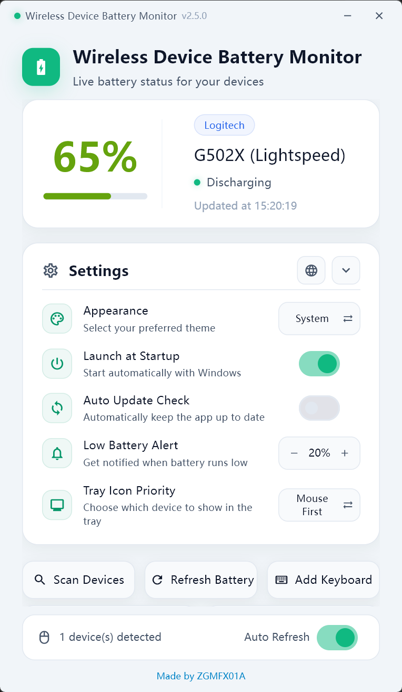

# Wireless Device Battery Monitor — Windows Mouse, Keyboard and Bluetooth Battery Monitor

[简体中文](README.md)

**Wireless Device Battery Monitor** is a lightweight Windows system-tray battery monitor for Logitech, Razer, and ASUS ROG wireless mice and keyboards, mechanical keyboards, and Windows-paired Bluetooth devices whose battery data is exposed through BLE Battery Service or Classic Bluetooth HFP. See battery percentage, charging state, last update time, and low-battery alerts without keeping a vendor control panel open.

[](https://www.python.org/)
[](https://www.microsoft.com/windows)
[](https://github.com/ZGMFX01A/mouse-battery/releases)
[](https://github.com/ZGMFX01A/Wireless-Device-Battery-Monitor/releases)
[](LICENSE)

## Download

- [Download the latest Windows build from GitHub Releases](https://github.com/ZGMFX01A/mouse-battery/releases)
- [Browse all releases and release notes](https://github.com/ZGMFX01A/mouse-battery/releases)

Download `WirelessDeviceBatteryMonitor-<version>.exe` and run it directly. No installer is required; the app stays in the Windows system tray.

## Product screenshot



The screenshot shows multi-device battery cards, charging state, low-battery threshold, startup launch, automatic updates, tray icon priority, and manual refresh. It uses the English UI; the app can switch between English and Simplified Chinese.

## Why Wireless Device Battery Monitor?

- **At-a-glance battery status**: See device name, battery percentage, charging state, and last update time from the tray or settings window.
- **Built for wireless peripherals**: Designed for Logitech, Razer, and ASUS ROG 2.4 GHz / Omni wireless mice and compatible HID devices.
- **Low-battery notifications**: Alerts cover mice, the bound keyboard, and added Bluetooth devices. Choose Off, 10%, 20%, or 30%.
- **Multiple devices**: Show several detected devices and bind multiple Windows-paired BLE or Classic Bluetooth battery devices.
- **Keyboard support**: Bind ASUS ROG wireless keyboards (direct / Omni) and compatible keyboards using the Huafenda protocol under `VID 0x0C45`, without a single-PID restriction.
- **Custom device names**: Rename a device on its card. Saved aliases also appear in the tray menu, tooltip, and low-battery notifications.
- **Quiet background utility**: Device scanning, manual refresh, session auto-refresh, startup launch, and bilingual UI in a small tray application.
- **Optional auto-update**: Check GitHub Releases and update the packaged app when you enable the option.

The project is also useful as a Windows mouse battery monitor, wireless mouse battery checker, Logitech battery monitor, Razer battery monitor, ASUS ROG battery monitor, HID battery utility, system tray battery app, or Bluetooth battery monitor.

## Supported devices

“Supported” and “Protocol support” mean that the relevant protocol is implemented; they do not imply hardware validation of every model and firmware. Only entries explicitly marked “Verified” indicate hardware validation. Compatibility also depends on the connection, firmware, and interface access.

### Razer wireless mice

| Device | Connection | Status |
| --- | --- | --- |
| Basilisk V3 Pro | 2.4 GHz wireless dongle | ✅ Verified |
| Viper V2 Pro | 2.4 GHz wireless dongle | 🔧 Theoretical support |
| DeathAdder V3 Pro | 2.4 GHz wireless dongle | 🔧 Protocol support |
| DeathAdder V3 | 2.4 GHz wireless dongle | 🔧 Protocol support |
| Viper Ultimate | 2.4 GHz wireless dongle | 🔧 Protocol support |
| Basilisk X Hyperspeed | 2.4 GHz wireless dongle | 🔧 Protocol support |
| Basilisk Ultimate | 2.4 GHz wireless dongle | 🔧 Protocol support |
| DeathAdder V2 Pro | 2.4 GHz wireless dongle | 🔧 Protocol support |

### Logitech wireless mice

| Device | Connection | Status |
| --- | --- | --- |
| G903 | LIGHTSPEED | ✅ Supported |
| G502 X | LIGHTSPEED | ✅ Supported |
| G703 | LIGHTSPEED | 🔧 Theoretical support |
| G Pro Wireless | LIGHTSPEED | 🔧 Theoretical support |
| PRO X SUPERLIGHT / PRO X SUPERLIGHT 2 | Compatible LIGHTSPEED receiver | 🔧 Protocol-compatible candidates; hardware validation required |

Logitech G HUB may occupy the HID interface needed for battery reads. If a Logitech device is not detected, close G HUB and select **Refresh Battery**. The current code enumerates known Lightspeed, Bolt, and Unifying receiver PIDs; the paired mouse still needs to expose a readable HID++ battery feature.

After the first successful battery read, the app attempts to retrieve the actual model name from the device. If that query fails, it keeps the default name. A user-defined alias takes precedence over the hardware name.

### ASUS ROG 2.4 GHz / Omni wireless mice

| Device Series / Model | Connection | Status |
| --- | --- | --- |
| ROG Harpe Ace Series (Aim Lab / Extreme / Mini / II Ace) | 2.4 GHz dongle / Omni Receiver | ✅ Supported |
| ROG Keris Series (Wireless / AimPoint / II Ace / Origin) | 2.4 GHz dongle / Omni Receiver | ✅ Supported |
| ROG Gladius III Series (Wireless / AimPoint / EVA-02) | 2.4 GHz dongle / Omni Receiver | ✅ Supported |
| ROG Gladius II Wireless / Strix Carry | 2.4 GHz dongle | ✅ Supported |
| ROG Chakram / Chakram X Wireless | 2.4 GHz dongle | ✅ Supported |
| ROG Spatha X Wireless | 2.4 GHz dongle | ✅ Supported |
| ROG Pugio II / Strix Impact II / Impact III | 2.4 GHz dongle / Omni Receiver | ✅ Supported |

Direct 2.4 GHz mice and Omni mice are detected automatically. The battery percentage syncs automatically when the mouse is powered on or wakes from sleep. When the mouse is powered off or asleep, the card explicitly displays **Not connected or asleep** without fabricating historical battery levels.

### ASUS ROG wireless mechanical keyboards

| Device Series / Model | Connection | Status |
| --- | --- | --- |
| ROG Azoth Series (Azoth / Extreme / Extreme SE / X) | 2.4 GHz dongle / Omni Receiver | ✅ Supported (via "Add keyboard") |
| ROG Strix Scope Series (Scope RX TKL / Scope II 96 / 96 RX) | 2.4 GHz dongle / Omni Receiver | ✅ Supported (via "Add keyboard") |
| ROG Falchion RX Low Profile | Omni Receiver | ✅ Supported (via "Add keyboard") |

Both direct 2.4 GHz and Omni keyboards can be identified and bound with a single click in Settings via **Add keyboard**. The card indicates offline/sleeping state whenever the keyboard goes to sleep or disconnects.

### Bluetooth LE devices

The app supports devices that are already paired with Windows and expose the standard Bluetooth Battery Service:

- Battery Service: `GATT 0x180F`
- Battery Level: `GATT 0x2A19`
- Multiple devices can be added; sleeping devices remain in the picker

### Classic Bluetooth headsets

For traditional Bluetooth headsets connected through the Windows audio path, the app reads the battery value exposed on the Windows Hands-Free (HFP) device node:

- The headset must be paired with Windows and connected
- The value comes from Windows HFP battery information, not from a generic BLE GATT service
- HFP normally does not expose charging state, so the app shows the percentage without guessing whether it is charging
- If the headset or driver does not expose HFP battery information, it may still appear in the picker with an unavailable battery value

Vendor-private protocols, devices that do not expose battery data to Windows, and HSP-only devices without usable HFP battery information remain outside the generic support boundary.

### Mechanical keyboards using the Huafenda protocol

Scanning now covers different PIDs under `VID 0x0C45` instead of only the NUT75 2.4 GHz receiver. This includes keyboards from Weikav, Ajazz, Langtu, and other brands that use a compatible Huafenda solution.

The app skips standard keyboard/mouse input interfaces and lists only vendor control interfaces that pass a Huafenda battery-protocol probe. **A matching brand or VID alone does not guarantee compatibility.** A sleeping device, an occupied interface, or a failed probe can prevent a keyboard from appearing in the picker.

Connect the 2.4 GHz receiver, then use **Add keyboard** in Settings to bind the device. The picker and card use the hardware-reported name, which may be `2.4G Dongle`. Use the card's edit button to assign a more recognizable alias.

## Quick start

1. Open [Releases](https://github.com/ZGMFX01A/mouse-battery/releases) and download the latest `WirelessDeviceBatteryMonitor-<version>.exe`.
2. Launch the executable and confirm that the Wireless Device Battery Monitor icon appears in the Windows system tray.
3. Connect the mouse or keyboard through its 2.4 GHz receiver; pair Bluetooth devices in Windows first.
4. Wait for the first scan, then select **Refresh battery** when needed.
5. Hover over the tray icon or open Settings to inspect detailed status.

If Windows SmartScreen blocks the unsigned executable on first launch, verify that the file came from this repository's Releases page before selecting **More info → Run anyway**.

## Common tasks

### View battery status

The settings window shows device name, battery percentage, charging state, and update time for each device. Choose the tray icon priority that fits your workflow:

- Mouse first
- Keyboard first
- Lowest battery first

### Configure low-battery alerts

Use the minus/plus control in Settings to choose Off, 10%, 20%, or 30%. Mice, the bound HID keyboard, and added Bluetooth devices track their alert state separately. Notifications use the device's custom name when set.

An alert is sent when an online, non-charging device first reports a valid, nonzero level at or below the threshold. Above 5%, another alert requires a drop of at least 5 percentage points; at 5% or below, each further 1-point drop can trigger an alert. Unchanged levels do not repeat alerts. Changing the threshold resets alert state.

### Rename a device

1. Select the pencil button in the upper-right corner of the device card and enter a name (up to 32 characters).
2. Press **Enter** or click outside the field to save. Press **Esc** to cancel.
3. Clear the field and save to restore the hardware or default name.

Aliases persist across restarts and apply to mice, keyboards, and Bluetooth devices. Separate receivers of the same mouse model can have different names. If changing a USB port or pairing again changes the device identifier, you may need to rename it again.

### Control auto-refresh

The **Auto Refresh** switch controls only status synchronization in the current window and is enabled by default. While visible, the GUI reads shared state from the tray process about once per second. This setting is not persisted and returns to enabled when the GUI restarts.

Hardware polling continues independently in the tray: mice are normally read every 60 seconds, charging can shorten the interval to 30 seconds, and repeated failures increase the retry interval. Keyboards and Bluetooth devices refresh every 60 seconds by default. Disabling window synchronization or hiding the window does not stop background monitoring.

### Add a Bluetooth device

1. Pair the device in Windows Bluetooth settings.
2. Open Wireless Device Battery Monitor Settings.
3. Select **Add Bluetooth Device** and wait for the paired-device list.
4. Choose a device and save it. BLE devices need the standard Battery Service; Classic Bluetooth headsets need Windows HFP battery information.

Added Bluetooth cards can be removed individually and added again later from the paired-device list.

### Bind a mechanical keyboard

1. Connect the keyboard through its 2.4 GHz receiver or Omni Receiver.
2. Open Settings and select **Add keyboard**.
3. Wait for the scan to find ASUS ROG wireless keyboards and Huafenda-protocol keyboards that pass the probe.
4. Select the target keyboard and save the binding.

Only one HID keyboard binding is retained. To switch keyboards, use the card's remove button to unbind the current device, then add the replacement. Multiple mice and Bluetooth devices can still be shown together.

### Enable startup launch or auto-update

Both options can be enabled independently in Settings. Startup launch uses the current user's Windows startup entry. Auto-update checks GitHub Releases only after you enable it.

### Switch the interface language

Click the language button in the upper-right corner of the Settings card to switch between Simplified Chinese and English. By default, the app follows the Windows UI language.

### Customize the appearance

Choose System, Light, or Dark appearance, adjust glass transparency, and select a capsule, vertical battery, number, or circle tray icon. Glass transparency changes only the window background.

## Troubleshooting

### My mouse is not detected

Check the following in order:

1. Logitech, Razer, and ASUS ROG mice are connected through a 2.4 GHz / Omni wireless receiver; BLE devices and Classic Bluetooth headsets are added through **Add Bluetooth Device**.
2. The model is listed above or belongs to a compatible protocol family.
3. Logitech users have closed G HUB.
4. Select **Refresh battery**; if the HID interface is still occupied, try running the app as administrator.

### The tray popup flashes and closes, or reports `BrowserProcessExited`

If a tray-managed window encounters a WebView2 failure during startup, reopening, or display, the app preserves the open request and recreates the window once. Repeated failures produce a tray notification; click again to retry. Failures while the window is hidden only release its process. Installation problems, such as a missing runtime, still display their guidance.

Before creating its GUI child process, the app sets `RTSSHooksCompatibility=0` in that child's environment, which is inherited by its WebView2 children. Direct GUI launches also set it before initialization. This declaration is scoped to the app's GUI process tree; it changes neither system environment variables nor RTSS profiles and does not affect other apps or games launched from the desktop. It was verified with RTSS 7.3.5.28314; behavior may vary with other versions or forced hooking settings.

Graphics API hooking from RivaTuner Statistics Server (RTSS, often used with MSI Afterburner) is one possible conflict to investigate. Neither `BrowserProcessExited` nor the presence of RTSS confirms the cause. If errors persist, check the RTSS version and any `ForceHooking=1` setting. Seeing `RTSSHooks64.dll` loaded does not by itself mean the declaration failed: the system can still load it without installing graphics API hooks. See the [developer notes](docs/dev/rtss-compatibility.md) for sources and local verification.

To check whether RTSS is involved, you can disable injection for **`msedgewebview2.exe`** in RTSS yourself (this also affects other WebView2 apps):

1. Open RTSS, select **Add**, and choose the WebView2 Runtime's `msedgewebview2.exe`. A common location is `C:\Program Files (x86)\Microsoft\EdgeWebView\Application\<version>\msedgewebview2.exe`; use the actual installation path on your PC.
2. Select the new profile and set **Application detection level** to **None**. Turning off **Show On-Screen Display** alone does not disable injection.
3. Exit and reopen the battery monitor, then repeatedly open and dismiss the popup to verify that it stays open when expected.

Alternatively, exit RTSS first and create `msedgewebview2.exe.cfg` in the `Profiles` folder under its installation directory with the following contents. If the file already exists, update only `EnableHooking` in its existing `[Hooking]` section and preserve the other settings:

```ini
[Hooking]
EnableHooking=0
```

Save the file, then reopen RTSS and the battery monitor. This profile applies to all WebView2 processes named `msedgewebview2.exe`; individual game profiles do not need changes. Because the crash occurs in the WebView2 child process, excluding only `WirelessDeviceBatteryMonitor.exe` may not cover it. Recreate processes that already have the injected DLL before verifying the result.

`BrowserProcessExited` indicates an unexpected WebView2 browser process exit and is not specific to RTSS. If no such error appears and the GUI process remains alive after the popup disappears, the window may have failed to acquire focus and been automatically hidden; a disappearing popup alone does not prove an RTSS crash. If RTSS is not running, or the problem persists after excluding it, include the error message, Windows and app versions, reproduction steps, and any other graphics overlay tools in your Issue. See [Microsoft's WebView2 process failure documentation](https://learn.microsoft.com/en-us/microsoft-edge/webview2/concepts/process-related-events).

### The battery shows `N/A` or does not update

The device may be sleeping, newly connected, waiting for its first scan, or temporarily unavailable through HID. Select **Refresh battery** and wait for the next automatic refresh. Unreadable data is not presented as a fake successful value.

### A Huafenda-protocol keyboard is missing from Add keyboard

Wake the keyboard, connect its 2.4 GHz receiver, close vendor software that may occupy the control interface, and scan again. The Huafenda protocol path requires `VID 0x0C45` and a compatible battery response; a matching brand or VID is not sufficient. Scanning has a time limit, so unresponsive interfaces can also affect discovery on a particular scan. Try scanning again.

### Why does my device show as `2.4G Dongle` or a generic receiver name?

That is the hardware-reported product string, which may differ from the keyboard model. Use the card's pencil button to set an alias. For Logitech mice, the app also attempts to read the actual model after the first successful battery read and keeps the default name if that query fails.

### Why is the value different from the vendor driver?

Small differences can result from refresh timing, device sleep state, or percentage conversion. Compare readings taken at the same time.

### Why can’t I find my BLE device?

BLE devices need the standard `0x180F` / `0x2A19` battery service; Classic Bluetooth headsets are matched through their Windows Hands-Free (HFP) endpoint. Windows endpoints belonging to the same physical device are deduplicated. Vendor-private protocols and devices that do not expose battery data cannot be read through the generic paths.

### The settings window says “Failed to Read Device Status”

The settings window reads shared state written by the tray process and does not access HID directly. Make sure the main app is still running, then select **Refresh Battery**. Restart the main app if the tray process has exited.

### What network does auto-update use?

When enabled, the updater requests release metadata from this project's GitHub Releases and downloads updates. If the GitHub direct link is unavailable, the updater may use a backup download source. The app does not require an account or upload mouse, keyboard, or battery data.

## Run from source and build

These steps are for maintainers who have access to the private core source or package. The public shell depends on `mouse-battery-core`; cloning only the public repository and installing `requirements.txt` is insufficient.

1. Prepare Windows and Python 3.10+, then create and activate a virtual environment.
2. For initial setup, create `.private-requirements.txt` and specify an accessible private core path. For a sibling checkout, use `-e ../mouse-battery-core`. Reuse an existing configuration if you already have one.
3. Install dependencies and start the app from the public shell directory:

```powershell
python -m pip install -r requirements.txt
python -m pip install -r .private-requirements.txt
python main.py
```

The GUI uses pywebview / WebView2. If a source run reports a missing `webview` module, install `requirements.txt` in the same Python environment that runs the app.

Build the single-file executable:

```powershell
python -m pip install pyinstaller
python build.py
```

The output is `dist/WirelessDeviceBatteryMonitor.exe`. The build script collects the private core and GUI dependencies. After building, wait for the smoke-test process and check its actual exit code in PowerShell:

```powershell
$smokeExe = (Resolve-Path './dist/WirelessDeviceBatteryMonitor.exe').Path
$smokeProcess = Start-Process -FilePath $smokeExe -ArgumentList @('--smoke-test') -Wait -PassThru -WindowStyle Hidden
if ($smokeProcess.ExitCode -ne 0) {
    throw "Smoke test failed with exit code $($smokeProcess.ExitCode)"
}
```

The smoke test checks core imports and manager initialization without scanning hardware or opening the GUI. Device communication and window behavior require separate validation. See the [portable update notes](docs/dev/portable-updates.md) and [packaged executable checks](docs/dev/release-workflow.md) for more details (Chinese).

## Search keywords

Windows mouse battery monitor, wireless mouse battery checker, Logitech G903 battery, Logitech G502 X battery, Razer battery monitor, ASUS ROG battery monitor, ROG mouse battery, ROG keyboard battery, ROG Omni Receiver, wireless keyboard battery monitor, mechanical keyboard battery status, Bluetooth LE Battery Service, HID++ battery, Windows system tray utility, low-battery notification.

## Privacy, security, and license

- No account is required. The app does not collect or upload device names, battery levels, or HID data.
- Network access is used for GitHub Releases version checks and update downloads.
- This project uses a non-commercial license. Personal learning, modification, and non-commercial use are allowed. Commercial sales, paid distribution, commercial integration, paid enterprise deployment, and other profit-making use require prior written permission from the copyright holder.
- Read the full terms in [LICENSE](LICENSE).

## Feedback and contributions

When reporting a compatibility issue, include your Windows version, device model, connection method, app version, and reproduction steps. Do not attach personal files, complete raw HID captures, or other sensitive information.

Compatibility reports and user feedback are welcome through Issues. Protocol implementations and the private core package are maintained outside this public repository.
