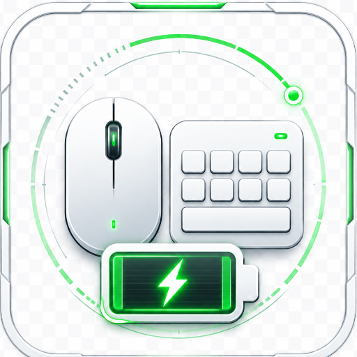
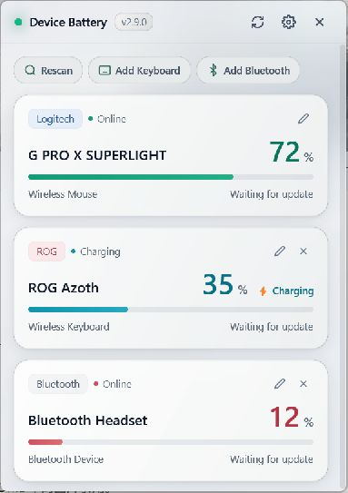
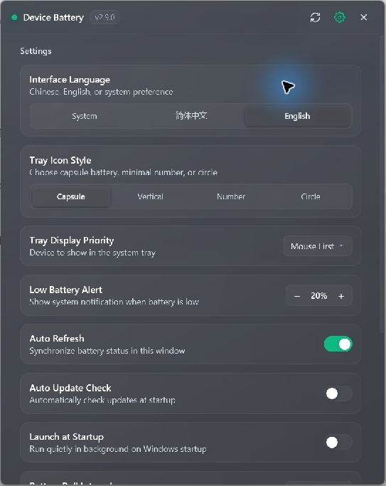

# Wireless Device Battery Monitor

**Your mouse, keyboard, and headset batteries — right on the taskbar.**

No more opening driver apps one by one, or remembering to charge only after a peripheral dies.

 

 

[-black?style=flat-square&logo=windows&logoColor=white)](https://github.com/zed-industries/zed)

[简体中文](README.md) | **English** | [Русский](README.ru.md)

 

[**⬇ Download for Windows**](https://github.com/ZGMFX01A/Wireless-Device-Battery-Monitor/releases) &nbsp;·&nbsp; [What's new](https://github.com/ZGMFX01A/Wireless-Device-Battery-Monitor/releases) &nbsp;·&nbsp; [Report an issue](https://github.com/ZGMFX01A/Wireless-Device-Battery-Monitor/issues)

[Highlights](#features) · [Preview](#preview) · [Quick Start](#quick-start) · [Devices](#devices) · [Compatible Mode](#compatible-mode) · [FAQ](#faq)

 

---

## 🖼️ At a Glance

<table>
  <tr>
    <th align="center">Light device panel</th>
    <th align="center">Dark device panel</th>
  </tr>
  <tr>
    <td align="center"></td>
    <td align="center"></td>
  </tr>
</table>

Click the tray icon to open the device panel: large battery numbers, connection status, and last update time on one screen.

View settings

 

| Light settings | Dark settings |
| :---: | :---: |
|  |  |

 

---

## ✨ Fewer Interruptions, More Peace of Mind

<table>
  <tr>
    <td width="50%" valign="top">
      <h3>🔋 Battery at a glance</h3>
      One tray icon, four styles: capsule, vertical bar, number, or ring. 
      Prioritize your mouse, your keyboard, or whichever device is <b>lowest</b>.
    </td>
    <td width="50%" valign="top">
      <h3>📌 Several devices, side by side on the taskbar</h3>
      Click the pin on a card to show multiple devices on the taskbar at once. 
      Place them left of the tray or left of the taskbar; add a translucent backdrop for transparent taskbars.
    </td>
  </tr>
  <tr>
    <td width="50%" valign="top">
      <h3>🏷️ All devices together, named your way</h3>
      Mice are detected through their receiver; keyboards and Bluetooth devices each have an add button. 
      Click the pencil to rename — “Office mouse”, “Travel headphones” — and tooltips and reminders follow.
    </td>
    <td width="50%" valign="top">
      <h3>🔔 Reminds you to charge, without nagging</h3>
      Thresholds of 10%, 20%, 30%, or off; each level triggers only once. 
      No reminders while a device reports charging or fully charged.
    </td>
  </tr>
  <tr>
    <td width="50%" valign="top">
      <h3>🎨 Easy on the eyes, your way</h3>
      Light, dark, or system theme, with adjustable frosted transparency. 
      Interface in Chinese, English, Russian, or following the system.
    </td>
    <td width="50%" valign="top">
      <h3>🌙 Quiet in the background, honest readings</h3>
      Monitoring continues with the panel closed; UI resources are freed after about 30 seconds idle. 
      If a battery can't be read, it says so — “unknown” never becomes 0%.
    </td>
  </tr>
</table>

> [!TIP]
> Hover over the tray icon to see device names, category icons, and color-coded battery levels; right-click for Settings, Refresh Now, or Quit. When a shared 2.4 GHz receiver can't identify the connected model, it shows the receiver's name and icon.

 

---

## 🚀 Three Steps to Start

**For 64-bit Windows 10 / 11.** A single portable executable — nothing to install.

1. **Download and run** — Get `WirelessDeviceBatteryMonitor-v<version>.exe` from the [releases page](https://github.com/ZGMFX01A/Wireless-Device-Battery-Monitor/releases), put it somewhere convenient, and double-click it.
2. **Add your devices** — Find the icon in the taskbar notification area and click it to open the panel. Mice are detected automatically once their receiver is plugged in. For a 2.4 GHz keyboard, plug in its receiver and choose “Add Keyboard”. Pair and connect Bluetooth devices in Windows first, then choose “Add Bluetooth”.
3. **Make it yours** — Pick the tray style, display priority, and reminder threshold, and turn on “Start with Windows” if you like.

> [!NOTE]
> No window at startup is normal — the app waits quietly in the tray. If you can't see the icon, check the hidden icons area on the right of the taskbar and drag it into the visible tray.

Upgrading from an older version / moving the app

 

- When upgrading, exit the old version from its tray menu before running the new one.
- Enabling startup in the new version removes the legacy startup entry only after successfully writing the new one. This also works if the old executable has already been deleted; there is no need to run it again.
- After moving or renaming the executable, enable “Start with Windows” again to update the same startup entry to the current path; disabling it removes that entry.

 

---

## 🎧 Which Devices Work?

Mice, keyboards, and headsets, over 2.4 GHz receivers and Bluetooth. **Support for a brand does not mean every model is supported** — expand for details.

View supported devices

 

| Device type | Supported models and connections |
| --- | --- |
| Logitech wireless mice | Selected LIGHTSPEED, Unifying, Bolt, and other receivers with compatible mice, including supported models in the G502 X, G903, and PRO X SUPERLIGHT families. |
| Razer wireless mice | Selected HyperSpeed wireless mice, including supported models in the Basilisk, Viper, and DeathAdder families. |
| ASUS ROG wireless peripherals | Selected wireless mice, keyboards, and Omni receiver combinations. The pairing list may be unavailable on some Omni receivers. See [Issue #3](https://github.com/ZGMFX01A/Wireless-Device-Battery-Monitor/issues/3). |
| Other wireless mice and keyboards | Selected MCHOSE, AULA, KYSONA, Weikav / NUT75, and ARDOR GAMING devices, depending on the model and connection mode. |
| Wireless headsets | Selected Logitech, Razer, ASUS ROG, MCHOSE, and HyperX models. HyperX covers Cloud II / II Core, III / III S, Alpha / Alpha 2, Flight / Flight S, Stinger Core, and Core Wireless on specific USB receivers. |
| HyperX wireless mice | Pulsefire Haste, Haste 2 / Core / Mini, and Dart on specific receivers; the original Haste also supports USB cable mode. |
| Bluetooth mice, keyboards, headphones, and more | Devices paired and connected in Windows that expose a readable battery level to the system. |

Changing a device's connection mode can also affect battery availability. For example, a keyboard's 2.4 GHz and Bluetooth modes require separate compatibility checks. Charging status and battery accuracy depend on the information provided by the device; some devices report a battery level without reporting whether they are charging.

Battery-powered peripherals can be monitored in USB mode when they report an actual battery level. Battery-free wired peripherals are excluded.

### 🧪 Model not listed? Try Compatible mode

Settings offer two recognition modes, and you can switch at any time:

| | Normal mode (default) | Compatible mode (experimental) |
| --- | --- | --- |
| Best for | Devices already on the supported list | Devices that share a brand and receiver with a supported model but aren't recognized yet |
| What it does | Uses only verified rules, stability first | Follows registered shared receivers to recognize sibling devices |
| How it shows | Exact model name and icon | Newly recognized devices get a generic name and category icon |

Compatible mode also has a second switch, **Probe unknown devices** (off by default). When enabled, it sends **read-only** battery queries to eligible unregistered wireless peripherals to try to read their battery level.

> [!NOTE]
> Devices already recognized or previously identified by exact model keep their names and icons in Compatible mode. Whether probing succeeds or not, use **Copy probe diagnostics** next to **Check Updates** in Settings and paste the report into an issue to help get your device officially supported; the report omits serial numbers and local paths.

Recognition modes in detail

 

- **Normal mode (default)**: uses the existing verified device and protocol rules.
- **Compatible mode (experimental)**: can be enabled in Settings after confirmation. By default, it only extends recognition to sibling devices paired with registered shared receivers and sends no active probes to unknown devices. Newly recognized sibling devices use a generic name and category icon. Known devices and devices previously identified by exact model retain their names and icons.
- **Probe unknown devices (experimental, off by default)**: a separate switch in Compatible mode. After confirmation, the first three controlled probe variants send read-only battery queries to eligible unregistered wireless peripherals. Use **Copy probe diagnostics** next to **Check Updates** in Settings to include a report in an issue. The report omits serial numbers and local paths.
- **Switching modes and downgrading**: bound devices that depend on probing stay listed as offline with a hint when you turn probing off or return to Normal mode. An older version without recognition modes ignores the new fields when it saves your settings. After upgrading again, restore the settings you need and re-add the devices that depend on them.

> [!TIP]
> Want your device supported? Use the [English device support form](https://github.com/ZGMFX01A/Wireless-Device-Battery-Monitor/issues/new?template=device-support.en.yml) ([简体中文](https://github.com/ZGMFX01A/Wireless-Device-Battery-Monitor/issues/new?template=device-support.zh-CN.yml) / [Русский](https://github.com/ZGMFX01A/Wireless-Device-Battery-Monitor/issues/new?template=device-support.ru.yml)). Include the **exact brand and model**, an **official driver download or official web driver URL**, and the hardware identification output, official-driver behavior, and tested sleep/charging/connection changes described in the [collection guide](docs/device-support.md#english).

 

---

## 💬 FAQ

<b>Why is there only an EXE on the releases page?</b>

 

Download the EXE directly. Build records and checksum files are kept in GitHub Actions artifacts, and the signature information needed by the updater is stored in the release notes, keeping the download list short. Versions that checked for updates using a separate JSON attachment need one manual download from the releases page; subsequent updates can be checked from within the app.

<b>Why does no window appear at startup?</b>

 

The app starts in the system tray. Click its battery icon to open the panel. Closing the panel keeps monitoring active; choose “Quit” from the tray's right-click menu to stop the app.

<b>What if an update is slow or the download disconnects?</b>

 

With automatic updates enabled, the app periodically checks for new versions. A temporary connection failure is retried later and does not interrupt battery monitoring. It contacts GitHub first, then automatically tries the GH-Proxy fallback download service if the connection fails. The fallback receives requests for public release information and application files only; it does not receive your device list or local settings.

Interrupted or canceled downloads can resume when retried. The app replaces the executable only after signature and integrity checks pass. It keeps the previous file before updating and attempts to roll back if the new version fails to start. The app remains a portable, single-file executable.

<b>What if a device is missing or its battery level does not change?</b>

 

Make sure the device has power and is in the correct connection mode. Try waking it, then rescan or refresh. Battery levels are polled periodically rather than changing every second, and some devices report only coarse steps. If reading still fails, the model, firmware, or connection mode may not yet be supported; if the device shares a brand and receiver with a supported model, try [Compatible mode](#compatible-mode).

The battery polling interval defaults to 30 seconds. Settings offer 5, 10, 15, 30, 60, 120, and 300 seconds; changes apply immediately and are saved automatically. Both online and offline devices are checked at the selected interval, without stopping polling or gradually extending retries for offline devices. Mice not found at startup, bound keyboards, and added Bluetooth devices are also rediscovered at this interval; a bound keyboard does not need to be added again when it returns. Manual refresh and “Refresh Now” in the tray menu remain available at any time. The interval starts after a read completes, so sequential reads across multiple devices or device timeouts can make the actual cycle longer.

When Windows re-enumerates a supported receiver-connected keyboard, the app searches for its current connection, preferring the recorded hardware serial number. If no serial number is available, it reconnects automatically only when the original receiver is gone, exactly one compatible receiver of the same model is present, and a battery read succeeds. The device name and alias are preserved, and the saved connection is reused on the next launch. If multiple receivers match, including receivers whose battery cannot currently be read, the app does not choose arbitrarily; select one through “Add Keyboard”. Failures distinguish a missing receiver, an unreadable battery, and a connection that could not be saved. Device arrival and removal notifications trigger recovery, with periodic polling as a fallback.

<b>What does the tray show when a device sleeps or disconnects?</b>

 

Readings come from the device or Windows. When a device is disconnected or its battery cannot be read, the app explains the status instead of presenting an unknown value as 0%; a reported 0% can still be a valid reading. If a device goes to sleep or disconnects and a read fails, it is excluded from tray battery selection, allowing the tray to show the remaining online devices.

<b>Why does a connected Bluetooth device have no battery level?</b>

 

A successful connection does not guarantee a readable battery level. Some peripherals use vendor-specific reporting or do not expose battery data to Windows, so a percentage may be unavailable.

<b>What does “Previous reading” mean?</b>

 

The current reading differs unusually from recent readings, so the app temporarily keeps the last trusted value and its original timestamp while waiting for another reading. This does not indicate a newly obtained battery value.

<b>How many devices can I add?</b>

 

Mice are detected automatically through supported receivers. You can currently bind one receiver-connected keyboard and add multiple Bluetooth devices.

<b>Why does the frosted background look different from the screenshots?</b>

 

Wallpaper, Windows version, system transparency settings, display scaling, and graphics hardware can all affect the appearance. Adjust transparency in settings; text and battery numbers remain opaque.

 

---

## 📮 Feedback and License

When reporting an [issue](https://github.com/ZGMFX01A/Wireless-Device-Battery-Monitor/issues), include the app version, Windows version, full device model, connection mode, and steps to reproduce. Screenshots can help; cover personal information before posting them publicly.

This project uses a custom license for personal learning and non-commercial use only. Commercial use requires prior explicit written permission from the copyright owner. See [LICENSE](LICENSE) for the full terms.

 
If it saved you from one dead mouse, a ⭐ Star would be appreciated.

