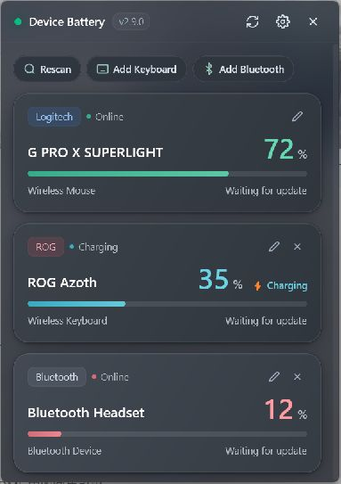
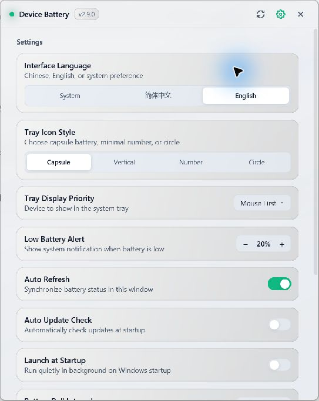

# Wireless Device Battery Monitor

[简体中文](README.md) | **English**

[-black?logo=windows&logoColor=white)](https://github.com/zed-industries/zed)

**Keep an eye on your mouse, keyboard, and Bluetooth device batteries from the taskbar.**

Skip opening several device utilities or waiting for a peripheral to run out of power. Wireless Device Battery Monitor lives in the Windows system tray, showing battery levels, charging status, and connectivity for supported devices, with a reminder when power runs low.

[Download for Windows](https://github.com/ZGMFX01A/Wireless-Device-Battery-Monitor/releases) · [What's new](https://github.com/ZGMFX01A/Wireless-Device-Battery-Monitor/releases) · [Report an issue](https://github.com/ZGMFX01A/Wireless-Device-Battery-Monitor/issues)

For 64-bit PCs running Windows 10 or 11. Download `WirelessDeviceBatteryMonitor-v<version>.exe` from the releases page, put it somewhere convenient, and run it directly.

## Stay informed with fewer interruptions

### Battery levels at a glance, using one tray icon

Choose from four tray styles: **capsule, vertical bar, number, or ring**. Prioritize your mouse, your keyboard, or the **lowest battery level** to keep the device that needs attention in view.

Hover over the icon to see device names, device icons, and color-coded battery levels. A shared 2.4 GHz receiver shows a receiver name and icon when its connected model cannot be identified. Click to open the device panel, or right-click for settings, an immediate refresh, or Exit.

### All your devices together, with names you choose

The device panel shows battery level, status, and the last update time. Mice are detected automatically through supported receivers. Use “Add Keyboard” for compatible 2.4 GHz keyboards and “Add Bluetooth” for Bluetooth devices.

Click the pencil on a device card to give it a familiar name such as “Office mouse” or “Travel headphones.” Aliases also appear in tray tooltips, menus, and low-battery notifications. You can currently bind one receiver-connected keyboard and add multiple Bluetooth devices.

### A reminder when it is time to charge

Set low-battery reminders to **10%, 20%, or 30%**, or turn them off. The same battery level does not trigger repeated reminders; further drops can trigger another notification. Devices explicitly reporting that they are charging or fully charged do not trigger low-battery notifications.

Readings come from the device or Windows. When a device is disconnected or its battery cannot be read, the app explains the status instead of presenting an unknown value as 0%; a reported 0% can still be a valid reading. If a device goes to sleep or disconnects and a read fails, it is excluded from tray battery selection, allowing the tray to show the remaining online devices.

### A comfortable interface and quiet background monitoring

Choose light, dark, or system theme, adjust the frosted background's transparency, and switch between Chinese, English, and Russian. Large battery numbers keep device cards easy to read.

Monitoring continues after you close the panel. After about 30 seconds of interface inactivity, the app releases UI resources; click the tray icon to open the panel again. You do not need to keep a window open for monitoring to continue.

## Preview

| Light device panel | Dark device panel |
| :---: | :---: |
|  |  |

View settings

| Light settings | Dark settings |
| :---: | :---: |
|  |  |

## Supported devices

| Device type | Supported models and connections |
| --- | --- |
| Logitech wireless mice | Selected LIGHTSPEED, Unifying, Bolt, and other receivers with compatible mice, including supported models in the G502 X, G903, and PRO X SUPERLIGHT families. |
| Razer wireless mice | Selected HyperSpeed wireless mice, including supported models in the Basilisk, Viper, and DeathAdder families. |
| ASUS ROG wireless peripherals | Selected wireless mice, keyboards, and Omni receiver combinations. The pairing list may be unavailable on some Omni receivers. See [Issue #3](https://github.com/ZGMFX01A/Wireless-Device-Battery-Monitor/issues/3). |
| Other wireless mice and keyboards | Selected MCHOSE, AULA, KYSONA, Weikav / NUT75, and ARDOR GAMING devices, depending on the model and connection mode. |
| Wireless headsets | Selected Logitech, Razer, ASUS ROG, and MCHOSE models. |
| Bluetooth mice, keyboards, headphones, and more | Devices paired and connected in Windows that expose a readable battery level to the system. |

**Support for a brand does not mean every model is supported. Changing a device's connection mode can also affect battery availability.** For example, a keyboard's 2.4 GHz and Bluetooth modes require separate compatibility checks. Charging status and battery accuracy depend on the information provided by the device; some devices report a battery level without reporting whether they are charging.

Battery-powered peripherals can be monitored in USB mode when they report an actual battery level. Battery-free wired peripherals are excluded.

## Getting started

1. **Find the tray icon.** The app starts in the taskbar notification area. If you do not see it, check the hidden icons area and drag the icon into the visible tray if desired.
2. **Open the panel and add devices.** Connect your mouse receiver and check automatic detection. For a supported 2.4 GHz keyboard, plug in its USB receiver and select “Add Keyboard.” Pair and connect Bluetooth devices, including Bluetooth keyboards, in Windows first, then select “Add Bluetooth.”
3. **Set your preferences.** Choose the tray style, display priority, and notification threshold. Enable “Start with Windows” in settings if desired. After moving or renaming the executable, enable it again to update the same startup entry to the current path; disabling it removes that entry.

When upgrading from an older version, exit it from its tray menu before running the new version. “Import legacy settings” can read your previous preferences. Device bindings and aliases are restored only when device identity can be matched unambiguously; add unmatched devices again. Enabling startup in the new version removes the legacy startup entry only after successfully writing the new one. This also works if the old executable has already been deleted; there is no need to run it again.

## Frequently asked questions

**Why is there only an EXE on the releases page?**

Download the EXE directly. Build records and checksum files are kept in GitHub Actions artifacts, and the signature information needed by the updater is stored in the release notes, keeping the download list short. Versions that checked for updates using a separate JSON attachment need one manual download from the releases page; subsequent updates can be checked from within the app.

**Why does no window appear at startup?**

The app starts in the system tray. Click its battery icon to open the panel. Closing the panel keeps monitoring active; choose “Exit” from the tray's right-click menu to stop the app.

**What if an update is slow or the download disconnects?**

With automatic updates enabled, the app periodically checks for new versions. A temporary connection failure is retried later and does not interrupt battery monitoring. It contacts GitHub first, then automatically tries the GH-Proxy fallback download service if the connection fails. The fallback receives requests for public release information and application files only; it does not receive your device list or local settings.

Interrupted or canceled downloads can resume when retried. The app replaces the executable only after signature and integrity checks pass. It keeps the previous file before updating and attempts to roll back if the new version fails to start. The app remains a portable, single-file executable.

**What if a device is missing or its battery level does not change?**

Make sure the device has power and is in the correct connection mode. Try waking it, then rescan or refresh. Battery levels are polled periodically rather than changing every second, and some devices report only coarse steps. If reading still fails, the model, firmware, or connection mode may not yet be supported.

The battery polling interval defaults to 30 seconds. Settings offer 5, 10, 15, 30, 60, 120, and 300 seconds; changes apply immediately and are saved automatically. Both online and offline devices are checked at the selected interval, without stopping polling or gradually extending retries for offline devices. Mice not found at startup, bound keyboards, and added Bluetooth devices are also rediscovered at this interval; a bound keyboard does not need to be added again when it returns. Manual refresh and “Refresh now” in the tray menu remain available at any time. The interval starts after a read completes, so sequential reads across multiple devices or device timeouts can make the actual cycle longer.

When Windows re-enumerates a supported receiver-connected keyboard, the app searches for its current connection, preferring the recorded hardware serial number. If no serial number is available, it reconnects automatically only when the original receiver is gone, exactly one compatible receiver of the same model is present, and a battery read succeeds. The device name and alias are preserved, and the saved connection is reused on the next launch. If multiple receivers match, including receivers whose battery cannot currently be read, the app does not choose arbitrarily; select one through “Add keyboard.” Failures distinguish a missing receiver, an unreadable battery, and a connection that could not be saved. Device arrival and removal notifications trigger recovery, with periodic polling as a fallback.

**Why does a connected Bluetooth device have no battery level?**

A successful connection does not guarantee a readable battery level. Some peripherals use vendor-specific reporting or do not expose battery data to Windows, so a percentage may be unavailable.

**What does keeping the previous reading mean?**

The current reading differs unusually from recent readings, so the app temporarily keeps the last trusted value and its original timestamp while waiting for another reading. This does not indicate a newly obtained battery value.

**Why does the frosted background look different from the screenshots?**

Wallpaper, Windows version, system transparency settings, display scaling, and graphics hardware can all affect the appearance. Adjust transparency in settings; text and battery numbers remain opaque.

## Feedback and license

When reporting an [issue](https://github.com/ZGMFX01A/Wireless-Device-Battery-Monitor/issues), include the app version, Windows version, full device model, connection mode, and steps to reproduce. Screenshots can help; cover personal information before posting them publicly.

This project uses a custom license for personal learning and non-commercial use only. Commercial use requires prior explicit written permission from the copyright owner. See [LICENSE](LICENSE) for the full terms.
