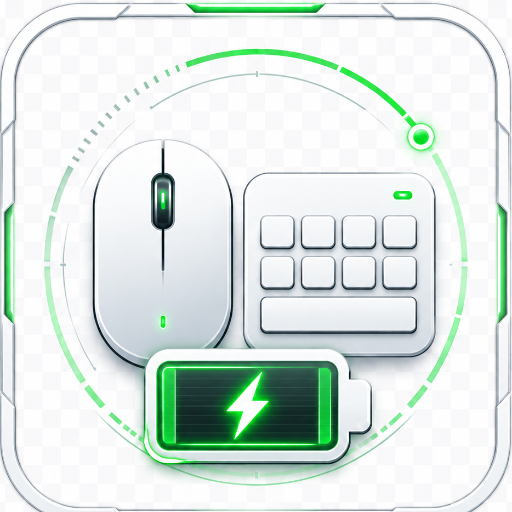
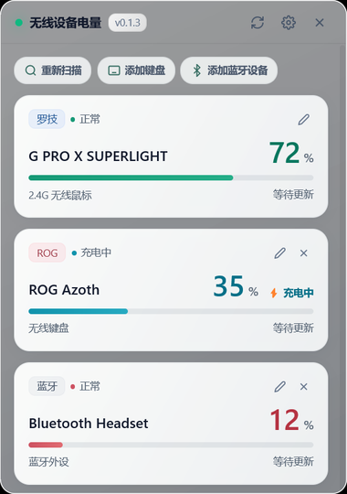
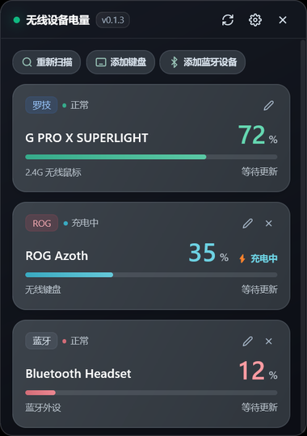
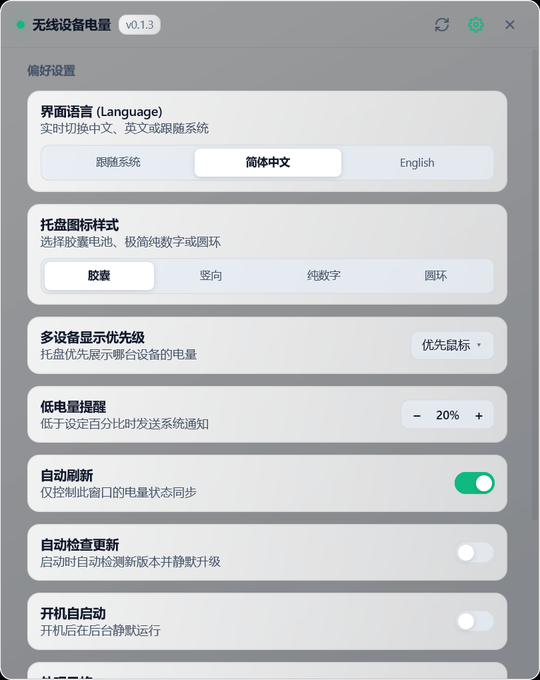
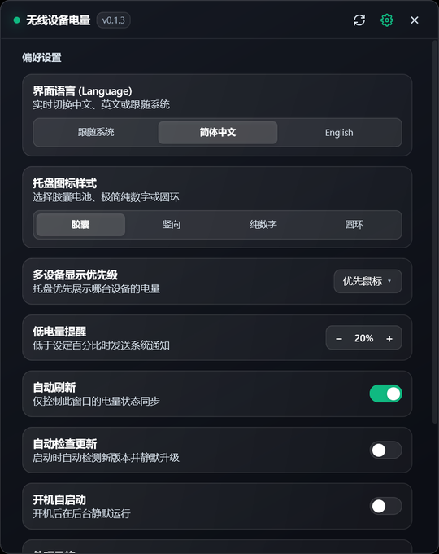

# 无线设备电量监控

**鼠标、键盘、耳机的电量，抬眼就在任务栏。**

不必挨个打开驱动，也不必等外设断电才想起充电。

 

 

[-black?style=flat-square&logo=windows&logoColor=white)](https://github.com/zed-industries/zed)

**简体中文** | [English](README.en.md) | [Русский](README.ru.md)

 

[**⬇ 下载 Windows 版**](https://github.com/ZGMFX01A/Wireless-Device-Battery-Monitor/releases) &nbsp;·&nbsp; [查看更新](https://github.com/ZGMFX01A/Wireless-Device-Battery-Monitor/releases) &nbsp;·&nbsp; [反馈问题](https://github.com/ZGMFX01A/Wireless-Device-Battery-Monitor/issues)

[功能亮点](#features) · [界面预览](#preview) · [快速上手](#quick-start) · [支持设备](#devices) · [兼容模式](#compatible-mode) · [常见问题](#faq)

 

---

## 🖼️ 界面一览

<table>
  <tr>
    <th align="center">浅色设备面板</th>
    <th align="center">深色设备面板</th>
  </tr>
  <tr>
    <td align="center"></td>
    <td align="center"></td>
  </tr>
</table>

单击托盘图标弹出设备面板：大号电量、连接状态、上次更新时间，一屏看完。

查看设置界面

 

| 浅色设置 | 深色设置 |
| :---: | :---: |
|  |  |

 

---

## ✨ 少一点打扰，多一点心里有数

<table>
  <tr>
    <td width="50%" valign="top">
      <h3>🔋 电量抬眼可见</h3>
      托盘只占一个位置，提供胶囊、竖条、数字、圆环四种样式。 
      可优先显示鼠标、键盘，或让<b>电量最低</b>的设备排到最前。
    </td>
    <td width="50%" valign="top">
      <h3>📌 多台设备，并排钉在任务栏</h3>
      点卡片上的图钉，把几台设备的电量同时固定到任务栏。 
      可放在托盘左侧或任务栏左侧，透明任务栏可加半透明底框。
    </td>
  </tr>
  <tr>
    <td width="50%" valign="top">
      <h3>🏷️ 设备集中看，名字你来定</h3>
      鼠标插上接收器即可识别，键盘与蓝牙设备各有添加入口。 
      点一下铅笔，改成“办公鼠标”“随身耳机”，提示和提醒都跟着变。
    </td>
    <td width="50%" valign="top">
      <h3>🔔 该充电时提醒，不反复催</h3>
      阈值可选 10%、20%、30% 或关闭；同一电量只提醒一次。 
      设备报告正在充电或已充满时，不再打扰。
    </td>
  </tr>
  <tr>
    <td width="50%" valign="top">
      <h3>🎨 界面合眼，随你调</h3>
      浅色、深色或跟随系统，磨砂通透度可调。 
      界面语言支持中文、英文、俄文或跟随系统。
    </td>
    <td width="50%" valign="top">
      <h3>🌙 后台安静，读数诚实</h3>
      关掉面板照常监控，闲置约 30 秒自动释放界面资源。 
      读不到电量就如实说明，不会把“未知”写成 0%。
    </td>
  </tr>
</table>

> [!TIP]
> 悬停托盘图标可查看设备名称、类别图标和彩色电量；右键可进入设置、立即刷新或退出。共享 2.4G 接收器无法确认具体型号时，会显示接收器名称和图标。

 

---

## 🚀 三步上手

**适用于 Windows 10 / 11（64 位）。** 单文件程序，无需安装。

1. **下载运行** —— 在 [发布页](https://github.com/ZGMFX01A/Wireless-Device-Battery-Monitor/releases) 下载 `WirelessDeviceBatteryMonitor-v版本号.exe`，放到常用位置后双击运行。
2. **添加设备** —— 在任务栏通知区域找到图标并单击打开面板。鼠标插上接收器即可自动识别；2.4G 键盘插入接收器后选「添加键盘」；蓝牙设备先在 Windows 中配对连接，再选「添加蓝牙设备」。
3. **按习惯设置** —— 选择托盘样式、显示优先级和提醒阈值，需要时开启“开机启动”。

> [!NOTE]
> 启动后没有窗口是正常的，它安静地待在托盘里。没看到图标时，检查任务栏右侧的折叠区域，可把图标拖到常显区域。

从旧版升级 / 移动程序位置

 

- 从旧版升级时，请先在旧版托盘菜单中退出，再运行新版。
- 开启新版“开机启动”时，会在确认新版自启动项写入成功后移除旧版自启动项；旧版文件已经删除也可直接开启，无需重新运行旧版。
- 程序移动或改名后，再开启一次“开机启动”即可将同一个启动项覆盖为当前路径；关闭时直接移除该启动项。

 

---

## 🎧 哪些设备可以使用？

鼠标、键盘、耳机，2.4G 接收器与蓝牙都覆盖。**同一品牌不代表所有型号都支持**，展开查看详细范围。

查看支持设备列表

 

| 设备类型 | 支持范围与连接方式 |
| --- | --- |
| 罗技无线鼠标 | 部分 LIGHTSPEED、Unifying、Bolt 等接收器与兼容鼠标，包含 G502 X、G903、PRO X SUPERLIGHT 等系列的适配。 |
| 雷蛇无线鼠标 | 部分 HyperSpeed 无线鼠标，包含 Basilisk、Viper、DeathAdder 等系列中的受支持型号。 |
| 华硕 ROG 无线外设 | 支持部分无线鼠标、键盘及 Omni 接收器组合。部分 Omni 接收器可能无法读取配对列表，见 [Issue #3](https://github.com/ZGMFX01A/Wireless-Device-Battery-Monitor/issues/3)。 |
| 其他无线鼠标和键盘 | 支持部分迈从、狼蛛、KYSONA、Weikav / NUT75 及 ARDOR GAMING 设备，视型号和连接方式而定。 |
| 无线耳机 | 支持部分罗技、雷蛇、华硕 ROG、迈从及 HyperX 型号。HyperX 包括指定 USB 接收器上的 Cloud II / II Core、III / III S、Alpha / Alpha 2、Flight / Flight S、Stinger Core 与 Core Wireless。 |
| HyperX 无线鼠标 | 支持指定接收器上的 Pulsefire Haste、Haste 2 / Core / Mini、Dart；初代 Haste 也支持 USB 数据线模式。 |
| 蓝牙鼠标、键盘、耳机等 | 已在 Windows 配对并连接，且向系统提供可读取电量的设备。 |

同一设备切换连接方式，能否读取电量也可能不同。例如，键盘的 2.4G 模式与蓝牙模式需要分别确认兼容性。充电状态和电量精度取决于设备提供的信息，部分设备只报告电量，不报告是否正在充电。

有电池的外设可在能够读取真实电量的 USB 模式下监控。纯有线、无电池的外设不纳入监控。

### 🧪 型号不在列表里？试试兼容模式

设置中提供两种识别模式，随时可切换：

| | 普通模式（默认） | 兼容模式（实验性） |
| --- | --- | --- |
| 适合谁 | 设备已在支持列表中 | 设备与已支持型号同品牌、共用接收器，但还没被识别 |
| 做什么 | 只按已验证的规则识别，稳定优先 | 顺着已登记的共享接收器，识别同源的其他子设备 |
| 显示方式 | 精确的型号名称和图标 | 新识别设备使用通用名称和品类图标 |

兼容模式里还有一个二级开关 **「探测未知设备」**（默认关闭）：开启后会向符合条件、尚未登记的无线外设发送**只读**电量查询，试着读出它的电量。

> [!NOTE]
> 已识别或曾精确命名的设备，切到兼容模式后仍保留原有名称和图标。探测成功或失败，都可以在设置页「检查更新」旁点击「复制探测诊断」，把报告贴进 Issue，帮助正式适配你的设备；报告会省略序列号与本机路径。

识别模式详细说明

 

- **普通模式（默认）**：沿用已验证的设备和协议规则。
- **兼容模式（实验性）**：可在设置中确认开启。默认仅扩展已登记共享接收器的同源子设备识别，不主动探测未知设备。新识别的同源设备使用通用名称和品类图标，已识别或曾精确命名的设备保留原有名称和图标。
- **探测未知设备（实验性，默认关闭）**：兼容模式的二级开关。确认开启后，首批三个受控探针变体会向符合条件的未登记无线外设发送只读电量查询。此时可在设置页「检查更新」旁点击「复制探测诊断」，将省略序列号与本机路径的报告贴入 Issue。
- **切换与降级**：关闭探测或切回普通模式后，依赖探测的已绑定设备会保留为离线，并提示如何恢复。若回退到不含识别模式的旧版本并保存设置，旧版会忽略这些新字段。再次升级后需恢复所需开关，并重新添加依赖这些设置的设备。

> [!TIP]
> 想让你的设备也被支持？请使用 [中文设备适配表单](https://github.com/ZGMFX01A/Wireless-Device-Battery-Monitor/issues/new?template=device-support.zh-CN.yml)（[English](https://github.com/ZGMFX01A/Wireless-Device-Battery-Monitor/issues/new?template=device-support.en.yml) / [Русский](https://github.com/ZGMFX01A/Wireless-Device-Battery-Monitor/issues/new?template=device-support.ru.yml)）提交申请，提供**品牌与完整型号**、**官方驱动下载地址或官方网页驱动地址**，并按 [设备信息采集说明](docs/device-support.md) 附上硬件识别信息、官方驱动表现和已测试的休眠/充电/连接切换结果。

 

---

## 💬 常见疑问

<b>发布页为什么只有 EXE？</b>

 

直接下载 EXE 即可。构建记录和校验文件保存在 GitHub Actions 产物中，自动更新所需的签名信息保存在发布说明中，不再单独占用下载列表。此前使用独立 JSON 附件检查更新的版本，需要从发布页手动下载一次新版，之后可继续在软件内检查更新。

<b>为什么启动后没有看到窗口？</b>

 

这是托盘工具的正常启动方式。单击任务栏中的电量图标即可打开面板；关闭面板不会退出后台监控，要停止程序请在托盘右键菜单中选择“退出”。

<b>自动更新下载慢，或者中途断开怎么办？</b>

 

开启自动更新后，程序会定期检查新版本；暂时连不上时稍后重试，不影响电量监控。默认先访问 GitHub，连接异常时自动尝试 GH-Proxy 备用下载服务。备用服务只用于获取公开的版本信息和程序文件，不会收到设备列表或本地设置。

下载中断或取消后，重试可以接着下载，不必每次从头开始。文件通过签名与完整性检查后才会替换程序，更新前保留旧文件，新版启动失败时会尝试回退。仍然是直接运行的单文件程序，不会改成安装包。

<b>找不到设备，或者电量没有变化怎么办？</b>

 

先确认设备有电、处于正确的连接模式，并尝试唤醒设备，再点击“重新扫描”或刷新。电量是定期读取的，不是每秒变化；有些设备也只按较大的档位上报电量。仍无法读取时，可能是型号、固件或连接方式尚不兼容；如果设备与已支持型号同品牌、共用接收器，可以试试 [兼容模式](#compatible-mode)。

设置中的“电量轮询间隔”默认 30 秒，可选 5、10、15、30、60、120、300 秒，修改后立即生效并自动保存。在线和离线设备都按所选间隔尝试读取，离线时不会停止轮询或逐渐拉长重试间隔。开机时尚未发现的鼠标、已绑定键盘或已添加的蓝牙设备，也会按此间隔重新发现；已绑定键盘恢复时无需重新添加。手动刷新和托盘右键“立即刷新”仍可随时触发读取。间隔按一次读取完成后计算，多设备依次读取或设备响应超时时，实际耗时可能更长。

受支持的接收器键盘在 Windows 重新识别后，会重新查找当前连接：优先匹配已记录的硬件序列号；没有可用序列号时，原接收器已消失且只有一个同型号兼容接收器、成功读到电量，才自动接续。设备名称和别名保留，连接保存后下次启动继续使用。多个匹配接收器（包括暂时读不到电量的接收器）不会被随意选中，请从“添加键盘”选择；读取失败会说明接收器未发现、电量暂不可读或连接保存失败。插拔通知会触发恢复，定时轮询继续兜底。

<b>设备休眠或断开后，托盘会显示什么？</b>

 

电量来自设备或 Windows 提供的读数。设备未连接、暂时读不到电量时，会说明状态，而不是把“未知”写成 0%；0% 本身仍可以是有效的设备读数。设备休眠或断开导致读取失败时，会退出托盘电量选择，托盘继续显示其余在线设备的电量。

<b>为什么蓝牙设备已经连接，却没有电量？</b>

 

连接成功不等于设备提供了可读取的电量。部分外设使用厂商专有方式上报，或者没有把电量交给 Windows；这类设备可能无法显示百分比。

<b>“沿用上次读数”是什么意思？</b>

 

程序发现本次读数与近期电量差异异常，暂时保留上次可信值和原更新时间，等待后续读取。它不表示刚刚取得了一笔新电量。

<b>可以绑定几台设备？</b>

 

鼠标通过受支持的接收器自动识别；目前可绑定一把接收器键盘，并添加多台蓝牙设备。

<b>为什么我的磨砂效果和截图不同？</b>

 

壁纸、Windows 版本、系统透明效果设置、显示缩放和显卡环境都会影响观感。可在设置中调节通透度；文字与电量数字不会随背景一起变透明。

 

---

## 📮 反馈与授权

遇到问题时，请在 [Issues](https://github.com/ZGMFX01A/Wireless-Device-Battery-Monitor/issues) 中说明软件版本、Windows 版本、设备完整型号、连接方式和复现步骤。附上截图会更容易定位；公开截图前请遮盖个人信息。

本项目采用自定义许可证，仅供个人学习和非商业使用；商业用途需事先获得著作权人的明确书面授权。完整条款见 [LICENSE](LICENSE)。

 
如果它帮你少错过了一次充电，欢迎点个 ⭐ Star。

