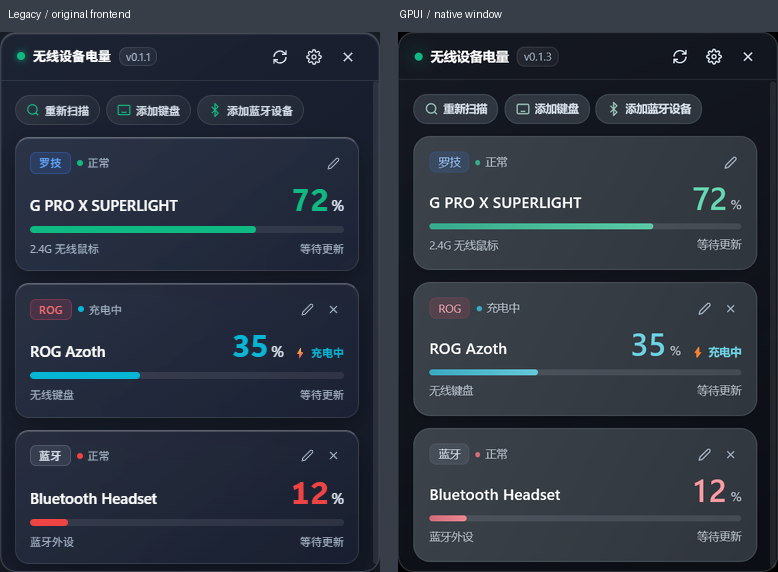

# 无线设备电量监控｜Windows 原生外设电量监控与管理工具

[](https://www.rust-lang.org/)
[-black?logo=windows&logoColor=white)](https://github.com/zed-industries/zed)
[](https://www.microsoft.com/windows)
[](https://github.com/ZGMFX01A/mouse-battery/releases)
[](https://github.com/ZGMFX01A/Wireless-Device-Battery-Monitor/releases)
[](LICENSE)

**无线设备电量监控（Wireless Device Battery Monitor）** 是一款专为 Windows 设计的超轻量级、高性能无线外设电量管理工具。它常驻于 Windows 系统任务栏托盘，实时监控 Logitech、Razer、ASUS ROG 鼠标与机械键盘、华奋达方案键盘以及标准蓝牙外设的电量百分比、充电阶段与在线状态，并提供贴心的低电量桌面弹窗提醒。

> **重大架构演变说明**：本项目已完成从原 Python + WebView2 架构向 **100% 纯 Rust + GPUI 原生驱动级架构** 的全面重构升级。彻底摒弃了 Chromium / Python 庞大运行时，常驻内存缩减至 15MB~25MB 级别，启动与交互延迟达到微秒级。  
> 原 Python 实现已完整归档于 Git Tag `legacy-python-v2.8.0` 及分支 `archive/legacy-python`。

---

## 立即下载

- **[下载最新 Windows 发行版（GitHub Releases）](https://github.com/ZGMFX01A/mouse-battery/releases)**
- **[查看全部版本更新日志与产物校验和](https://github.com/ZGMFX01A/mouse-battery/releases)**

> **便携绿色运行**：下载 `WirelessDeviceBatteryMonitor-<version>.exe` 后直接双击运行，无需任何安装器或环境配置，不依赖任何外部 Web 运行时，启动后即自动最小化常驻至 Windows 系统任务栏托盘。

---

## 产品实机截图与效果对照

### 1. 原生 GPUI 设备浮窗与设置中心

| 深色模式（原生 GPUI 浮窗 380×540） | 浅色模式（原生 GPUI 浮窗 380×540） |
| :---: | :---: |
|  |  |

| 深色模式设置与多设备管理（540×680） | 浅色模式设置与设备发现（540×680） |
| :---: | :---: |
|  |  |

### 2. 原版 Web 前端 vs GPUI 原生窗口 1:1 对照

> 下图采集自实机测试套件（`验收对照.html`）：左侧为基于 HTML/CSS/WebView2 的原版界面，右侧为重构后纯 Rust GPUI 原生窗口。不仅 100% 严谨还原了排版间距与视觉规范，更带来了 Direct3D 硬件加速与毫秒级即时动画。



---

## 核心技术架构与工程亮点

### 1. 极致轻量与闲置资源回收（30s Resource Harvesting）
- **无 Web 前端开销**：基于 GPU 加速的 Rust GPUI 框架构建原生 Direct3D 窗口，杜绝 WebView2 带来的数百兆内存驻留与多进程臃肿。
- **30 秒闲置自动休眠**：浮窗和设置窗口关闭 30 秒后，应用将自动销毁底层 HWND 句柄、释放 Direct3D 渲染上下文与显存缓存，仅由极简 Win32 托盘宿主常驻监听。再次唤出浮窗仅需数百毫秒，真正做到“用时即开、闲时无感”。

### 2. 双通道非阻塞采样与防卡死架构
- **硬件 I/O 线程彻底解耦**：独立的 `HID Worker` 与 `Bluetooth Worker` 后台线程专职处理 USB 报文读写与 WinRT GATT 异步通信，与 UI 渲染主线程通过无锁并发消息通道连接。
- **超时与错误熔断**：外设关闭电源、休眠或超出无线信号范围时，后台轮询自动熔断并进入指数退避重连，界面绝不卡顿白屏。

### 3. Windows 现代电源管理与快速恢复（Modern Standby）
- **全链路电源广播监听**：全面捕获 Windows `WM_POWERBROADCAST` 状态转移（挂起事件 4、用户按键/移动唤醒事件 7、系统自动唤醒事件 18），支持合并去重防抖。
- **晃动即连**：电脑从睡眠（S3/S4/现代待机）唤醒后，仅需晃动鼠标即可瞬时触发底层重新握手与电量采集，彻底解决旧版“唤醒后必须手动刷新”的问题。

### 4. 驱动级滤波与 Win32 托盘投影去重
- **异常跳变拦截（Held State）**：外设在低电压或无线瞬态干扰下若产生跳变毛刺，状态机会自动保留上一次可信电量与在线状态，界面显式标注“沿用上次读数”并推迟重试，杜绝设备在托盘频繁闪烁或被误踢下线。
- **GDI 句柄颠簸根绝**：托盘状态解耦为 `icon_key`、`tip_text` 与 `menu_items` 独立投影，只有视觉键变更时才调用 Win32 GDI 绘制，消除高频时间戳刷新带来的系统资源浪费。

---

## 支持设备与协议矩阵

> 注：下列“协议支持”表示代码已完成协议级解析与形式化测试，实际使用效果取决于具体设备固件与无线接收器工作模式。明确标记“已验证”的型号已在物理机实测通过。

### 1. Logitech 无线鼠标与接收器（HID++ 协议栈）
* **支持连接**：LIGHTSPEED 2.4G 无线接收器、Bolt 接收器、Unifying 接收器。
* **协议机制**：HID++ 1.0 / 2.0 / 4.5 寻址；支持 Feature `0x1000` (Battery Level)、`0x1004` (Voltage Curve 13 点滤波曲线) 与 `0x1001` (Battery Unified)。
* **充电管理**：精准识别充饱状态（`Charge::Full`），充饱时智能回退至 60 秒低频心跳，避免高频唤醒外设。首次读电成功后自动探测并读取设备真实出厂型号名称。
* **典型型号**：
  - G502 X LIGHTSPEED（✅ 已验证）
  - G903 LIGHTSPEED（✅ 已支持）
  - PRO X SUPERLIGHT / SUPERLIGHT 2（🔧 协议兼容）
  - G703 / G Pro Wireless（🔧 协议兼容）

### 2. Razer 无线鼠标（2.4G HyperSpeed）
* **协议机制**：标准 90 字节 Feature Report 结构校验，内置独有动态 CRC 算法，支持干电池与锂电池差异化轮询。
* **典型型号**：
  - Basilisk V3 Pro（巴塞利斯蛇 V3 Pro，✅ 已验证）
  - Viper V2 Pro / DeathAdder V3 Pro（🔧 协议支持）
  - Viper Ultimate / Basilisk Ultimate / DeathAdder V2 Pro（🔧 协议支持）

### 3. ASUS ROG 无线外设
* **协议机制**：支持 ROG Omni 接收器多设备报文关联与直连无线报文解析。
* **典型型号**：ROG Azoth / ROG Gladius 系列无线键鼠（🔧 协议兼容）。

### 4. 机械键盘（华奋达方案）
* **协议机制**：支持 `VID 0x0C45` 自定义握手协议。自动识别 Windows 驱动接口，优先绑定 `UsagePage 0xFF60` / `Interface 3` 私有控制端点，杜绝主键输入接口冲突。
* **典型型号**：Weikav 机械键盘、NUT75 机械键盘（✅ 已验证）。

### 5. 蓝牙外设（BLE GATT & 经典蓝牙）
* **BLE 外设**：读取标准 GATT Battery Service（`0x180F` / `0x2A19`），通过 WinRT API 实现安全的作用域 RAII 释放。
* **经典蓝牙**：通过 Windows Hands-Free Profile（HFP）端点与 SetupAPI 批量安全枚举耳机与音箱电量。

---

## 软件功能概览

- **直观视觉呈现**：任务栏托盘支持电量百分比、胶囊图标、双击即开、鼠标悬停详细 Tooltip 气泡展示。
- **现代化原生界面**：支持 Windows 浅色（Light）与深色（Dark）模式自动切换，支持 0% / 25% / 100% 磨砂亚克力玻璃材质调节。
- **自定义别名与多设备管理**：点击卡片铅笔按钮可自定义设备名称，别名将自动同步至托盘菜单、提示文案与低电量提醒。
- **分级低电量桌面通知**：支持 10%、20%、30% 多档阈值提醒，智能过滤初始化 0% 虚假读数，杜绝骚扰。
- **开机自启与免安装便携**：基于 Windows 注册表原生自启机制，单文件绿色免安装，解压即用。

---

## 仓库架构与协同开发指南

本项目采用 **双仓协同与 Workspace 分离架构**：
- **`mouse-battery`**（当前仓库）：负责 Windows 原生 GUI 渲染、系统托盘管理、IPC 管道通讯与发布流水线。
- **`mouse-battery-core`**（私有协议核心库）：负责底层 HID 原始报文通信、WinRT 蓝牙驱动栈抽象与各品牌解密/CRC 算法实现。

```text
mouse-project-root/
├── mouse-battery/          # [当前仓库] GPUI 原生托盘主程序
│   ├── Cargo.toml
│   ├── src/                # GPUI 视图、托盘宿主、Win32 状态机
│   ├── assets/             # 矢量图标、实机截图与 Win32 原生资源清单
│   └── private-core-ref.json # 私有核心库引用与 CI 检出配置
├── mouse-battery-core/     # [核心仓库] 底层通信协议解析库 (battery-protocol)
│   ├── Cargo.toml
│   └── src/                # HID++、Razer、ROG、Weikav、BLE 解码器
├── Cargo.toml              # 根目录 Cargo Workspace (方便联合构建)
└── Cargo.lock              # 依赖精确锁定文件
```

### 1. 本地从源码构建

开发建议将两个仓库克隆至**同级目录**，通过根目录 Cargo Workspace 统一构建：

```powershell
# 1. 递归克隆或分别克隆至平级目录
git clone https://github.com/ZGMFX01A/mouse-battery.git
git clone https://github.com/ZGMFX01A/mouse-battery-core.git

# 2. 进入主应用目录运行单元与回归测试 (60 项测试)
cd mouse-battery
cargo test

# 3. 编译高度优化的单文件 Release 版本
cargo build --release --locked

# 4. 执行二进制冒烟验证
.\target\release\mouse-battery-gpui.exe --smoke-test
```

### 2. GitHub Actions 远程自动打包流水线

项目已内置完整的 CI/CD 自动化打包工作流（`.github/workflows/release.yml`）：
- **多仓鉴权机制**：在主仓库设置 `PRIVATE_CORE_REPOSITORY` 和 `PRIVATE_CORE_ACCESS_TOKEN`（Personal Access Token），CI 构建机将自动并行拉取私有协议库。
- **自动化发版流程**：只需向仓库推送以 `v` 开头的标签（例如 `v0.1.3`），GitHub Actions 将全自动运行测试套件、构建 Release PE 文件、验证冒烟退出码、生成 SHA-256 校验和并自动发布至 GitHub Releases。

---

## 常见问题（FAQ）

### Q1：为什么提示“读取设备失败”或找不到罗技鼠标？
- 部分罗技设备可能被官方 Logitech G HUB 独占占用 HID 通道。若初次探测失败，请尝试完全退出 G HUB 进程，随后在软件中点击“刷新”。
- 确保无线接收器已牢固插入 USB 接口（非只充电的线缆）。

### Q2：华奋达方案键盘在扫描中无法识别？
- 请确认键盘已拨至 2.4G 模式且接收器已插入电脑。
- 程序会对 `VID 0x0C45` 的所有接口进行智能优先级探测，若有第三方灯控驱动独占了控制端点，可能需要先关闭驱动软件后再次扫描。

### Q3：为什么蓝牙设备搜不到？
- 设备必须首先在 Windows 系统“蓝牙和其他设备”中完成配对与连接。
- 设备需公开标准的 BLE Battery Service（`0x180F`）或支持免提通话（HFP）协议。部分厂商完全私有的蓝牙协议不支持通用抓取。

### Q4：程序常驻时的实际资源占用是多少？
- 在窗口关闭（闲置超 30 秒）状态下，Direct3D 渲染器与窗口完全释放，仅托盘进程监听底层事件，物理内存占用仅在 **15MB ~ 25MB** 之间，后台 CPU 占用几乎为 **0.0%**。

---

## 许可证说明

本项目遵循开源规范与非商业个人使用授权。详细条款请参阅仓库内 [LICENSE](LICENSE) 文件。
