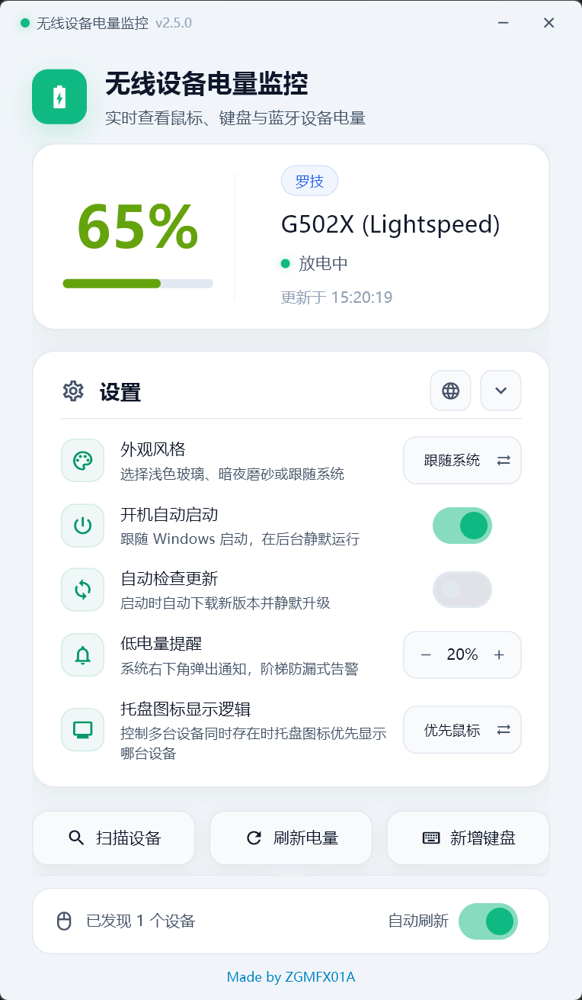

# 无线设备电量监控｜Windows 无线鼠标、键盘与蓝牙电量监控

[English](README.en.md)

**无线设备电量监控（Wireless Device Battery Monitor）** 是一个轻量、常驻 Windows 系统托盘的电量监控工具，用于查看 Logitech、Razer、ASUS ROG 无线鼠标键盘、机械键盘和兼容蓝牙设备的实时电量、充电状态和低电量提醒。

[](https://www.python.org/)
[](https://www.microsoft.com/windows)
[](https://github.com/ZGMFX01A/mouse-battery/releases)
[](https://github.com/ZGMFX01A/Wireless-Device-Battery-Monitor/releases)
[](LICENSE)

## 立即下载

- [下载最新 Windows 版本（GitHub Releases）](https://github.com/ZGMFX01A/mouse-battery/releases)
- [查看所有版本与更新说明](https://github.com/ZGMFX01A/mouse-battery/releases)

下载 `WirelessDeviceBatteryMonitor-<version>.exe` 后直接运行，无需安装器。程序启动后会驻留在 Windows 系统托盘。

## 产品截图



截图展示了多设备电量卡片、充电状态、低电量通知阈值、开机自启、自动更新、托盘图标优先级和手动刷新等功能。

## 为什么使用无线设备电量监控？

- **一眼查看电量**：在托盘图标或设置窗口中查看设备名称、电量百分比、充电状态和最近更新时间。
- **适合无线外设**：面向 Logitech、Razer、ASUS ROG 2.4G/Omni 无线鼠标和部分 HID 无线外设设计。
- **低电量提醒**：鼠标、已绑定键盘和蓝牙设备均支持提醒，可选择关闭、10%、20%、30% 四档阈值。
- **多设备管理**：可同时展示多个已识别设备，也可添加多个 Windows 已配对的 BLE 或经典蓝牙电量设备。
- **键盘扩展**：支持 ASUS ROG 无线机械键盘（直连 / Omni），以及采用华奋达协议的兼容 `VID 0x0C45` 键盘，不再限制单一 PID。
- **设备自定义名称**：在设备卡片上修改名称，别名会保存，并同步用于托盘菜单、悬停提示和低电量通知。
- **轻量常驻**：系统托盘运行，支持扫描设备、手动刷新、会话级自动刷新、开机自启和中英文界面。
- **可选自动更新**：从 GitHub Releases 检查新版本并完成更新，是否启用由用户决定。

这些能力也使它适合作为 Windows mouse battery monitor、wireless mouse battery checker、Logitech battery monitor、Razer battery monitor、ASUS ROG battery monitor、HID battery utility 和 Bluetooth battery monitor 使用。

## 支持范围

下列“已支持 / 协议支持”表示代码已实现对应协议，不等于所有型号与固件都经过真机验证；明确标记“已验证”的设备除外。实际可用性还取决于连接方式、固件和接口访问情况。

### Razer 无线鼠标

| 设备 | 连接方式 | 状态 |
| --- | --- | --- |
| Basilisk V3 Pro（巴塞利斯蛇 V3 Pro） | 2.4G 无线接收器 | ✅ 已验证 |
| Viper V2 Pro（毒蝰 V2 Pro） | 2.4G 无线接收器 | 🔧 理论支持 |
| DeathAdder V3 Pro（蝰蛇 V3 Pro） | 2.4G 无线接收器 | 🔧 协议支持 |
| DeathAdder V3（蝰蛇 V3） | 2.4G 无线接收器 | 🔧 协议支持 |
| Viper Ultimate（毒蝰终极版） | 2.4G 无线接收器 | 🔧 协议支持 |
| Basilisk X Hyperspeed（巴塞利斯蛇 X 极速版） | 2.4G 无线接收器 | 🔧 协议支持 |
| Basilisk Ultimate（巴塞利斯蛇终极版） | 2.4G 无线接收器 | 🔧 协议支持 |
| DeathAdder V2 Pro（蝰蛇 V2 Pro） | 2.4G 无线接收器 | 🔧 协议支持 |

### Logitech 无线鼠标

| 设备 | 连接方式 | 状态 |
| --- | --- | --- |
| G903 | LIGHTSPEED | ✅ 已支持 |
| G502 X | LIGHTSPEED | ✅ 已支持 |
| G703 | LIGHTSPEED | 🔧 理论支持 |
| G Pro Wireless | LIGHTSPEED | 🔧 理论支持 |
| PRO X SUPERLIGHT / PRO X SUPERLIGHT 2 | 兼容的 LIGHTSPEED 接收器 | 🔧 协议兼容候选，需真机验证 |

Logitech 设备的电量读取可能会与 Logitech G HUB 争用 HID 接口。读取失败时，请先退出 G HUB，再点击“刷新电量”。当前代码按已知接收器 PID 枚举 Lightspeed、Bolt 和 Unifying 接收器，具体鼠标仍取决于设备暴露的 HID++ 电量能力。

首次成功读取电量后，程序会尝试从设备获取真实型号名称；查询失败时保留默认名称。用户设置的别名优先于硬件名称。

### ASUS ROG 2.4G / Omni 无线鼠标

| 设备系列 / 型号 | 连接方式 | 状态 |
| --- | --- | --- |
| ROG Harpe Ace 系列（Aim Lab / Extreme / Mini / II Ace） | 2.4G 接收器 / Omni 接收器 | ✅ 已支持 |
| ROG Keris 系列（Wireless / AimPoint / II Ace / Origin） | 2.4G 接收器 / Omni 接收器 | ✅ 已支持 |
| ROG Gladius III 系列（Wireless / AimPoint / EVA-02） | 2.4G 接收器 / Omni 接收器 | ✅ 已支持 |
| ROG Gladius II Wireless / Strix Carry | 2.4G 接收器 | ✅ 已支持 |
| ROG Chakram / Chakram X Wireless | 2.4G 接收器 | ✅ 已支持 |
| ROG Spatha X Wireless | 2.4G 接收器 | ✅ 已支持 |
| ROG Pugio II / Strix Impact II / Impact III | 2.4G 接收器 / Omni 接收器 | ✅ 已支持 |

直连 2.4G 鼠标与 Omni 鼠标均自动识别。设备开机或从休眠唤醒后会自动同步电量；设备关机或休眠时，状态卡片将明确提示“未连接或处于休眠状态”，不会伪造历史电量。

### ASUS ROG 无线机械键盘

| 设备系列 / 型号 | 连接方式 | 状态 |
| --- | --- | --- |
| ROG Azoth 系列（Azoth / Extreme / Extreme SE / X） | 2.4G 接收器 / Omni 接收器 | ✅ 已支持（通过“新增键盘”绑定） |
| ROG Strix Scope 系列（Scope RX TKL / Scope II 96 / 96 RX） | 2.4G 接收器 / Omni 接收器 | ✅ 已支持（通过“新增键盘”绑定） |
| ROG Falchion RX Low Profile | Omni 接收器 | ✅ 已支持（通过“新增键盘”绑定） |

直连 2.4G 与 Omni 键盘均可在设置窗口中通过“新增键盘”一键识别并保存绑定。键盘休眠或断开连接时同样会显示离线休眠状态。

### Bluetooth LE 设备

支持已经与 Windows 配对、并向系统公开标准 Bluetooth Battery Service 的设备：

- Battery Service：`GATT 0x180F`
- Battery Level：`GATT 0x2A19`
- 可添加多个设备；设备休眠时仍会保留在候选列表中

### 经典蓝牙耳机

对于通过 Windows 音频链路连接的传统蓝牙耳机，程序会读取 Windows 暴露在 Hands-Free（HFP）设备节点上的电量属性：

- 设备需要先与 Windows 配对，并处于已连接状态
- 电量来源是 Windows HFP 电量信息，不是通用 BLE GATT 服务
- 充电状态通常不会由 HFP 属性提供，界面会显示电量但不猜测充电状态
- 如果耳机或驱动没有向 Windows 暴露 HFP 电量，设备仍可能出现在列表中，但电量会显示为不可用

仅使用厂商私有蓝牙协议、没有向 Windows 暴露电量，或只支持 HSP 而没有可用 HFP 电量信息的设备，不属于当前通用读取范围。

### 华奋达方案机械键盘

扫描范围已从单一 NUT75 2.4G 接收器扩展到 `VID 0x0C45` 下的不同 PID，包括采用兼容华奋达方案的 Weikav（维咖）、Ajazz（黑爵）、Langtu（朗图）等品牌键盘。

程序会跳过标准键盘 / 鼠标输入接口，只将通过华奋达电量协议探测的厂商控制接口展示为可绑定设备。**相同品牌或 VID 不代表一定兼容**；握手失败、设备休眠或接口被占用时，设备可能不会出现在候选列表中。

通过 2.4G 接收器连接后，在设置窗口中使用“新增键盘”完成绑定。候选列表和设备卡片使用硬件报告的名称，因此接收器可能显示为 `2.4G Dongle`；可以通过卡片上的编辑按钮设置易识别的别名。

## 快速开始

1. 打开 [Releases](https://github.com/ZGMFX01A/mouse-battery/releases)，下载最新的 `WirelessDeviceBatteryMonitor-<version>.exe`。
2. 双击运行程序，确认 Windows 系统托盘出现“无线设备电量监控”图标。
3. 使用 2.4G 接收器连接鼠标或键盘；蓝牙设备先在 Windows 中完成配对。
4. 等待首次扫描；需要时点击“刷新电量”。
5. 将鼠标悬停在托盘图标上，或打开设置窗口查看详细状态。

如果 Windows SmartScreen 首次拦截未签名程序，请确认文件来自本仓库的 Releases，再选择“仍要运行”。

## 常用操作

### 查看设备电量

设置窗口会为每个设备显示名称、电量百分比、充电状态和更新时间。托盘图标可按以下策略显示设备：

- 鼠标优先
- 键盘优先
- 显示电量最低的设备

### 设置低电量提醒

在设置窗口使用减号/加号调整提醒阈值，可选择关闭、10%、20% 或 30%。鼠标、已绑定的 HID 键盘和已添加的蓝牙设备分别记录提醒状态，通知中使用自定义名称。

设备在线、未充电，且首次读到不高于阈值的有效非零电量时，会发送 Windows 低电量通知。此后电量高于 5% 时，每继续下降至少 5 个百分点提醒一次；电量不高于 5% 时，每下降 1 个百分点提醒一次。相同电量不会反复弹出通知；修改阈值会重置提醒状态。

### 修改设备名称

1. 点击设备卡片右上角的铅笔按钮，输入新名称（最多 32 个字符）。
2. 按 **Enter** 或点击输入框外保存；按 **Esc** 取消本次编辑。
3. 清空名称并保存，可恢复硬件名称或默认名称。

别名会在重启后保留，适用于鼠标、键盘和蓝牙设备。同型号的不同鼠标接收器可分别命名；如果更换 USB 接口或重新配对导致设备标识变化，可能需要重新命名。

### 控制自动刷新

底部“自动刷新”开关只控制当前窗口的状态同步，默认开启。窗口显示时约每 1 秒读取一次托盘进程的共享状态；该开关不会写入配置，重启 GUI 后恢复开启。

托盘硬件轮询独立运行：鼠标通常每 60 秒读取一次，充电时可缩短到 30 秒，连续失败时逐步延长重试间隔；键盘和蓝牙设备默认每 60 秒刷新。关闭窗口同步或收起窗口后，托盘监控仍会继续。

### 添加蓝牙设备

1. 先在 Windows 蓝牙设置中完成设备配对。
2. 打开“无线设备电量监控”设置窗口。
3. 点击“添加蓝牙设备”，等待 Windows 已配对设备列表加载。
4. 选择设备并保存；BLE 设备需要公开标准 Battery Service，经典蓝牙耳机需要 Windows 提供 HFP 电量信息。

已添加的蓝牙设备卡片可以单独移除，之后可从已配对设备列表重新添加。

### 绑定机械键盘

1. 确认键盘通过 2.4G 接收器或 Omni 接收器连接。
2. 打开设置窗口并点击“新增键盘”。
3. 等待扫描完成，选择 ASUS ROG 无线键盘或通过协议探测的华奋达方案键盘。
4. 选择目标键盘并保存绑定。

当前只保留一把 HID 键盘的绑定。更换键盘时，可先通过卡片右上角的移除按钮解除绑定，再重新添加；多个鼠标和蓝牙设备仍可同时显示。

### 开机自启与自动更新

两项功能都可以在设置窗口单独开关。开机自启使用当前用户的 Windows 启动项；自动更新只在用户开启后检查 GitHub Releases。

### 切换界面语言

点击设置卡片右上角的语言按钮即可在简体中文和 English 之间切换；默认会根据 Windows UI 语言选择界面语言。

### 调整外观

设置中可选择跟随系统、浅色或暗夜外观，调整磨砂通透度，并选择胶囊、竖向电池、纯数字或圆环托盘图标。磨砂通透度只影响窗口背景。

## 常见问题

### 托盘弹窗闪一下就关闭，或提示 `BrowserProcessExited`？

如果同时运行了 RivaTuner Statistics Server（RTSS，常与 MSI Afterburner 配合使用），可能是 RTSS 的图形注入与 WebView2 冲突。已定位的崩溃案例中，`RTSSHooks64.dll` 访问了已卸载的 `dxgi.dll` 内存，导致 WebView2 浏览器进程退出，随后电量监控弹窗关闭。这类冲突也可能在程序启动一段时间后才出现。

推荐在 RTSS 中为 **`msedgewebview2.exe`** 禁用注入：

1. 打开 RTSS，点击 **Add**，选择 WebView2 Runtime 的 `msedgewebview2.exe`。常见位置为 `C:\Program Files (x86)\Microsoft\EdgeWebView\Application\<版本号>\msedgewebview2.exe`，实际路径以本机安装位置为准。
2. 选中刚添加的配置，将 **Application detection level** 设置为 **None**。仅关闭 **Show On-Screen Display** 不等于禁用注入。
3. 退出电量监控程序后重新打开，连续尝试打开、收起弹窗，确认不再闪关。

也可以手动配置：先退出 RTSS，再在其安装目录的 `Profiles` 文件夹内新建 `msedgewebview2.exe.cfg`，写入以下内容；若文件已存在，只修改已有 `[Hooking]` 节中的 `EnableHooking`，保留其他配置：

```ini
[Hooking]
EnableHooking=0
```

保存后重新打开 RTSS 和电量监控程序。该配置针对所有名为 `msedgewebview2.exe` 的 WebView2 进程，游戏的独立配置无需调整。崩溃发生在 WebView2 子进程中，因此只排除 `WirelessDeviceBatteryMonitor.exe` 可能覆盖不到；已经注入的进程需要重新创建后再验证。

`BrowserProcessExited` 表示 WebView2 浏览器进程异常退出，并不专指 RTSS。如果没有该错误、弹窗消失后 GUI 进程仍在运行，也可能是窗口未取得焦点而被自动收起，不能仅凭“闪关”判断为 RTSS 崩溃。未运行 RTSS，或排除后仍出现问题时，请在 Issue 中提供错误提示、Windows 与程序版本、复现步骤，以及是否运行其他图形叠加工具；参见 [微软 WebView2 故障事件说明](https://learn.microsoft.com/zh-cn/microsoft-edge/webview2/concepts/process-related-events)。

### 检测不到鼠标怎么办？

请依次确认：

1. Logitech、Razer、ASUS ROG 鼠标通过 2.4G / Omni 无线接收器连接；BLE 设备和经典蓝牙耳机通过“添加蓝牙设备”流程绑定。
2. 设备属于支持列表或同一协议系列。
3. Logitech 用户已经退出 G HUB。
4. 点击“刷新电量”；若 HID 接口仍被占用，可尝试以管理员身份运行。

### 电量显示为 N/A 或长时间不更新？

设备可能正在休眠、刚刚连接、尚未完成首次扫描，或暂时无法访问 HID 接口。先点击“刷新电量”，并等待下一次自动刷新。程序不会把无法读取的数据伪装成有效电量。

### 华奋达方案键盘没有出现在“新增键盘”列表中？

先唤醒键盘并确认 2.4G 接收器已连接，关闭可能占用控制接口的厂商驱动，再重新扫描。当前华奋达读取路径需要设备使用 `VID 0x0C45`，并能响应兼容的电量协议；仅有相同品牌或 VID 仍不足以判断支持。扫描有时间限制，其他接口无响应也可能影响本次发现结果，可再次扫描。

### 设备为什么显示为 `2.4G Dongle` 或通用接收器名称？

这是硬件报告的产品字符串，不一定是键盘型号。可点击卡片上的铅笔按钮设置别名；对于 Logitech 鼠标，程序还会在首次成功读电后尝试读取真实型号，查询失败时保留默认名。

### 为什么官方驱动和本程序的电量不完全一样？

少量差异通常来自刷新时间点、设备休眠状态或百分比换算方式。请以同一时刻的数据进行比较。

### BLE 设备为什么搜不到？

BLE 设备需要已与 Windows 配对并公开标准 `0x180F` / `0x2A19` 电量服务；经典蓝牙耳机会通过 Windows 的 Hands-Free（HFP）端点识别。程序会合并同一物理设备的多个 Windows 端点；厂商私有协议或不公开电量的设备无法通过通用路径读取。

### 设置窗口提示“读取设备状态失败”怎么办？

设置窗口只读取托盘进程写入的共享状态，不直接访问 HID。请确认主程序仍在运行，再点击“刷新电量”；如果托盘进程已退出，请重新启动主程序。

### 自动更新访问哪些网络？

开启自动更新后，程序会访问本项目的 GitHub Releases 检查版本并下载更新。GitHub 直链不可用时，更新模块可能使用备用下载源；应用不会要求账号，也不会上传鼠标、键盘或电量数据。

## 从源码运行与打包

面向获得私有核心源码或安装包的维护者。公开壳仓库依赖 `mouse-battery-core`，仅克隆公开仓库并安装 `requirements.txt` 不足以运行。

1. 准备 Windows 和 Python 3.10+，创建并激活虚拟环境。
2. 首次配置时，创建 `.private-requirements.txt` 并填写可访问的私有核心路径。若私有仓库位于同级目录，可写入 `-e ../mouse-battery-core`；已有配置可直接复用。
3. 在公开壳仓库目录安装依赖并启动：

```powershell
python -m pip install -r requirements.txt
python -m pip install -r .private-requirements.txt
python main.py
```

GUI 使用 pywebview / WebView2。若源码运行提示缺少 `webview`，请在运行程序的同一 Python 环境安装 `requirements.txt`。

打包单文件 EXE：

```powershell
python -m pip install pyinstaller
python build.py
```

输出为 `dist/WirelessDeviceBatteryMonitor.exe`。构建脚本会收集私有核心和 GUI 依赖；打包后可在 PowerShell 中等待冒烟进程退出并检查实际退出码：

```powershell
$smokeExe = (Resolve-Path './dist/WirelessDeviceBatteryMonitor.exe').Path
$smokeProcess = Start-Process -FilePath $smokeExe -ArgumentList @('--smoke-test') -Wait -PassThru -WindowStyle Hidden
if ($smokeProcess.ExitCode -ne 0) {
    throw "Smoke test failed with exit code $($smokeProcess.ExitCode)"
}
```

冒烟检查只验证核心导入和管理器初始化，不扫描硬件或打开 GUI。设备通信和窗口行为仍需单独验证。便携更新与打包检查分别见 [便携更新说明](docs/dev/portable-updates.md) 和 [打包程序检查](docs/dev/release-workflow.md)。

## 搜索关键词

Windows 无线鼠标电量监控、Windows 鼠标电池监控、Logitech G903 电量、Logitech G502 X 电量、Razer 鼠标电量、ASUS ROG 鼠标电量、ROG 键盘电量、ROG Omni Receiver、无线键盘电量、机械键盘电量、Bluetooth LE Battery Service、HID++ 电量、系统托盘电量工具、低电量提醒、Windows battery monitor、mouse battery checker、ASUS ROG battery monitor。

## 隐私、安全与许可证

- 应用不需要登录，不收集账号信息，也不会上传设备名称、电量或 HID 数据。
- 访问网络仅用于 GitHub Releases 的版本检查和更新下载。
- 本项目采用非商业使用许可证。允许个人学习、修改和非商业运行；商业销售、付费分发、商业集成、企业收费部署及其他营利性用途均需事先取得版权所有者书面授权。
- 详细条款请阅读 [LICENSE](LICENSE)。

## 反馈与贡献

遇到设备兼容性问题时，请在 Issue 中提供 Windows 版本、设备型号、连接方式、程序版本和复现步骤。不要上传个人文件、完整 HID 原始数据或其他敏感信息。

欢迎通过 Issue 反馈兼容性信息和使用体验；协议实现与私有核心包不在本公开仓库中维护。
