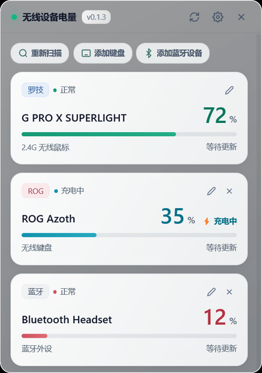
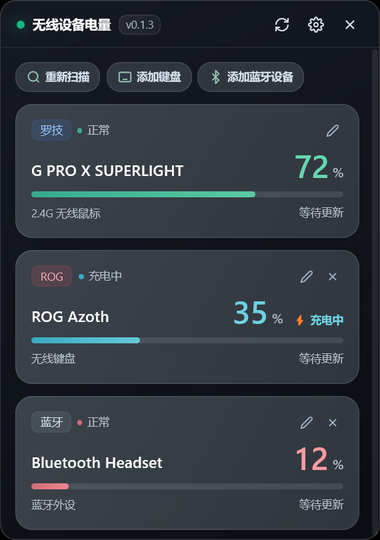
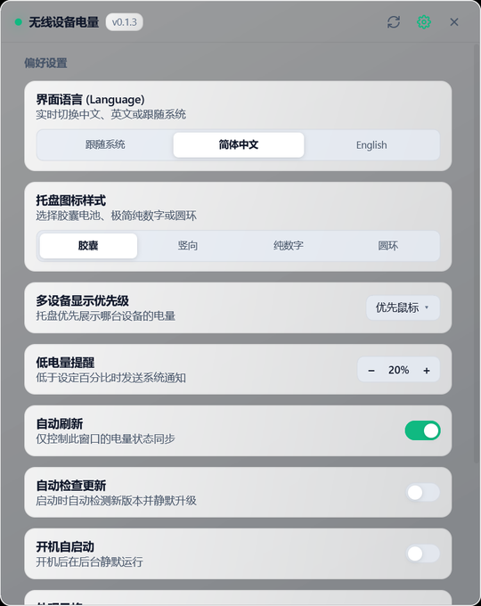
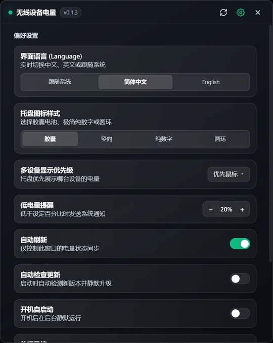

# 无线设备电量监控

[-black?logo=windows&logoColor=white)](https://github.com/zed-industries/zed)

**把鼠标、键盘和蓝牙设备的电量，放在任务栏的一角。**

不必分别打开几个设备管理软件，也不必等到外设突然断电才想起充电。无线设备电量监控常驻 Windows 托盘，帮你查看受支持设备的剩余电量、充电状态与连接情况，并在电量偏低时提醒你。

[下载 Windows 版](https://github.com/ZGMFX01A/Wireless-Device-Battery-Monitor/releases) · [查看更新](https://github.com/ZGMFX01A/Wireless-Device-Battery-Monitor/releases) · [反馈问题](https://github.com/ZGMFX01A/Wireless-Device-Battery-Monitor/issues)

适用于 Windows 10 / 11 的 64 位电脑。下载发布页中的 `WirelessDeviceBatteryMonitor-v版本号.exe`，放到常用位置后直接运行。

## 少一点打扰，多一点心里有数

### 电量抬眼可见，托盘只占一个位置

托盘提供**胶囊、竖条、数字、圆环**四种样式。你可以优先显示鼠标、优先显示键盘，也可以选择**低电量优先**，让最需要留意的电量出现在眼前。

鼠标悬停可查看设备电量汇总：设备名称加粗，电量按高、中、低显示绿、橙、红色，充电时显示青色，离线时显示灰色。单击打开设备面板，右键进入设置、立即刷新或退出，“退出”位于菜单最底部。不需要为每台设备挤进一个难以分辨的图标。

### 设备集中查看，名字由你来定

设备面板集中展示电量、状态和上次更新时间。鼠标通过受支持的接收器自动识别；键盘与蓝牙设备可以从各自的添加入口选择。

点一下卡片上的铅笔，就能把设备改成“办公鼠标”“随身耳机”等熟悉的名字。别名也会出现在托盘提示、菜单和低电量提醒中。目前可绑定一把接收器键盘，并添加多台蓝牙设备。

### 该充电时提醒，不反复催促

低电量提醒可设为 **10%、20% 或 30%**，也可以关闭。相同电量不会反复提醒；继续下降时，再按电量变化提醒。设备明确报告正在充电或已经充满时，不发送低电量提醒。

电量来自设备或 Windows 提供的读数。设备未连接、暂时读不到电量时，会说明状态，而不是把“未知”写成 0%；0% 本身仍可以是有效的设备读数。设备休眠或断开导致读取失败时，会退出托盘电量选择，托盘继续显示其余在线设备的电量。

### 界面合眼，后台安静

支持浅色、深色和跟随系统，可调节磨砂通透度，也可切换中英文。设备卡片保留清晰的大号电量，让查看这件事足够简单。

关闭面板后，后台监控继续运行；界面连续闲置约 30 秒后会释放资源，下次点击托盘再打开。不必一直开着窗口，也能保持后台监控。

## 界面预览

| 浅色设备面板 | 深色设备面板 |
| :---: | :---: |
|  |  |

查看设置界面

| 浅色设置 | 深色设置 |
| :---: | :---: |
|  |  |

## 哪些设备可以使用？

| 设备类型 | 支持范围与连接方式 |
| --- | --- |
| 罗技无线鼠标 | 部分 LIGHTSPEED、Unifying、Bolt 等接收器与兼容鼠标，包含 G502 X、G903、PRO X SUPERLIGHT 等系列的适配。 |
| 雷蛇无线鼠标 | 部分 HyperSpeed 无线鼠标，包含 Basilisk、Viper、DeathAdder 等系列中的受支持型号。 |
| 华硕 ROG 无线外设 | 部分无线鼠标、键盘及 Omni 接收器组合。 |
| Weikav / NUT75 等机械键盘 | 采用兼容方案的部分键盘，使用 2.4G 接收器连接。 |
| 蓝牙鼠标、键盘、耳机等 | 已在 Windows 配对并连接，且向系统提供可读取电量的设备。 |

**同一品牌不代表所有型号都支持；同一设备切换连接方式，能否读取电量也可能不同。** 例如，键盘的 2.4G 模式与蓝牙模式需要分别确认兼容性。充电状态和电量精度取决于设备提供的信息，部分设备只报告电量，不报告是否正在充电。

## 第一次使用

1. **运行后找托盘。** 程序启动后驻留在任务栏通知区域；没有看到图标时，检查右侧的折叠区域，并按需要将图标拖到常显区域。
2. **打开面板、添加设备。** 连接鼠标接收器后查看自动识别结果；键盘使用“添加键盘”，蓝牙设备先在 Windows 中完成配对与连接，再使用“添加蓝牙设备”。
3. **按习惯设置。** 选择托盘样式、显示优先级和提醒阈值。需要随 Windows 启动时，在设置中开启“开机启动”。程序移动或改名后，再开启一次即可将同一个启动项覆盖为当前路径；关闭时直接移除该启动项。

从旧版升级时，请先在旧版托盘菜单中退出，再运行新版。设置中的“导入旧版设置”可读取旧版偏好；设备绑定与别名仅在身份能够明确匹配时恢复，未匹配的设备可重新添加。开启新版“开机启动”时，会在确认新版自启动项写入成功后移除旧版自启动项；旧版文件已经删除也可直接开启，无需重新运行旧版。

## 常见问题

**发布页为什么只有 EXE？**

直接下载 EXE 即可。构建记录和校验文件保存在 GitHub Actions 产物中，自动更新所需的签名信息保存在发布说明中，不再单独占用下载列表。此前使用独立 JSON 附件检查更新的版本，需要从发布页手动下载一次新版，之后可继续在软件内检查更新。

**为什么启动后没有看到窗口？**

这是托盘工具的正常启动方式。单击任务栏中的电量图标即可打开面板；关闭面板不会退出后台监控，要停止程序请在托盘右键菜单中选择“退出”。

**找不到设备，或者电量没有变化怎么办？**

先确认设备有电、处于正确的连接模式，并尝试唤醒设备，再点击“重新扫描”或刷新。电量是定期读取的，不是每秒变化；有些设备也只按较大的档位上报电量。仍无法读取时，可能是型号、固件或连接方式尚不兼容。

设置中的“电量轮询间隔”默认 30 秒，可选 5、10、15、30、60、120、300 秒，修改后立即生效并自动保存。在线和离线设备都按所选间隔尝试读取，离线时不会停止轮询或逐渐拉长重试间隔。开机时尚未发现的鼠标、已绑定键盘或已添加的蓝牙设备，也会按此间隔重新发现；已绑定键盘恢复时无需重新添加。手动刷新和托盘右键“立即刷新”仍可随时触发读取。间隔按一次读取完成后计算，多设备依次读取或设备响应超时时，实际耗时可能更长。

**为什么蓝牙设备已经连接，却没有电量？**

连接成功不等于设备提供了可读取的电量。部分外设使用厂商专有方式上报，或者没有把电量交给 Windows；这类设备可能无法显示百分比。

**“沿用上次读数”是什么意思？**

程序发现本次读数与近期电量差异异常，暂时保留上次可信值和原更新时间，等待后续读取。它不表示刚刚取得了一笔新电量。

**为什么我的磨砂效果和截图不同？**

壁纸、Windows 版本、系统透明效果设置、显示缩放和显卡环境都会影响观感。可在设置中调节通透度；文字与电量数字不会随背景一起变透明。

## 反馈与授权

遇到问题时，请在 [Issues](https://github.com/ZGMFX01A/Wireless-Device-Battery-Monitor/issues) 中说明软件版本、Windows 版本、设备完整型号、连接方式和复现步骤。附上截图会更容易定位；公开截图前请遮盖个人信息。

本项目供个人学习和非商业使用，商业用途需事先获得授权。完整条款见 [LICENSE](LICENSE)。
