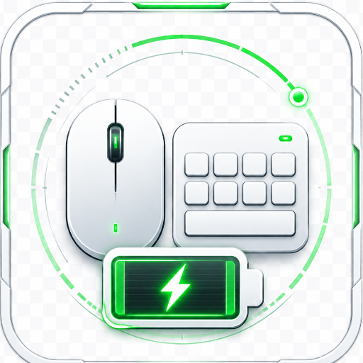
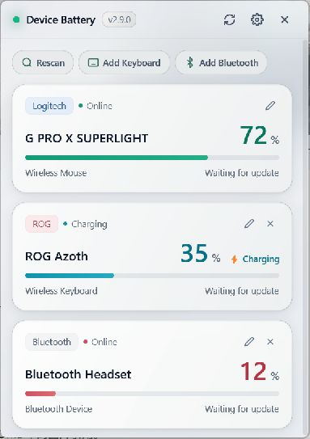
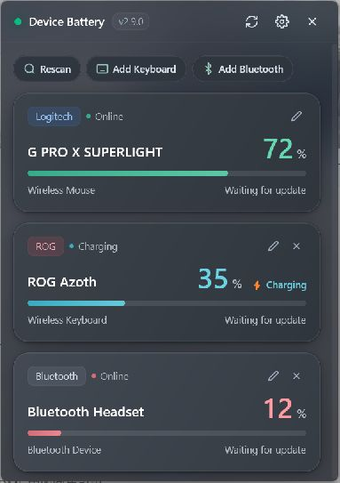
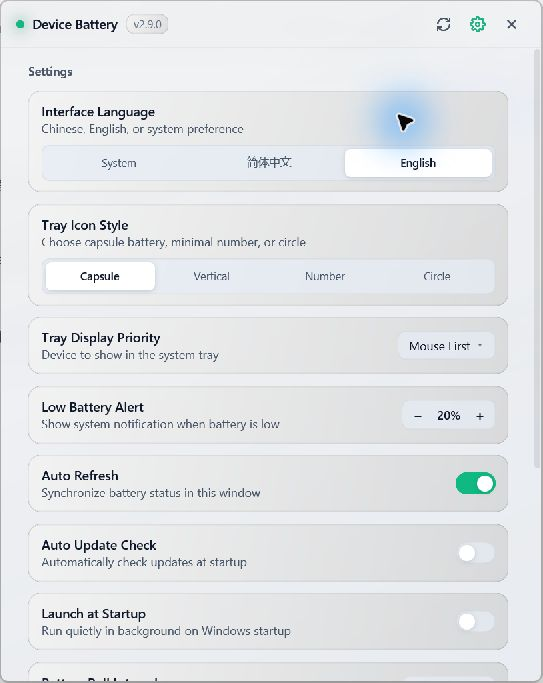
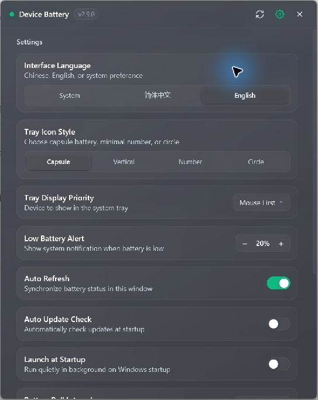

# Wireless Device Battery Monitor

**Заряд мыши, клавиатуры и гарнитуры — прямо на панели задач.**

Не нужно открывать фирменные утилиты по очереди или вспоминать о зарядке, когда устройство уже село.

 

 

[-black?style=flat-square&logo=windows&logoColor=white)](https://github.com/zed-industries/zed)

[简体中文](README.md) | [English](README.en.md) | **Русский**

 

[**⬇ Скачать для Windows**](https://github.com/ZGMFX01A/Wireless-Device-Battery-Monitor/releases) &nbsp;·&nbsp; [Что нового](https://github.com/ZGMFX01A/Wireless-Device-Battery-Monitor/releases) &nbsp;·&nbsp; [Сообщить о проблеме](https://github.com/ZGMFX01A/Wireless-Device-Battery-Monitor/issues)

[Возможности](#features) · [Скриншоты](#preview) · [Быстрый старт](#quick-start) · [Устройства](#devices) · [Совместимый режим](#compatible-mode) · [Вопросы](#faq)

 

---

## 🖼️ Как это выглядит

<table>
  <tr>
    <th align="center">Светлая панель устройств</th>
    <th align="center">Тёмная панель устройств</th>
  </tr>
  <tr>
    <td align="center"></td>
    <td align="center"></td>
  </tr>
</table>

Щёлкните значок в трее — откроется панель: крупные цифры заряда, состояние подключения и время обновления на одном экране. На скриншотах показан английский интерфейс.

Показать окно настроек

 

| Светлые настройки | Тёмные настройки |
| :---: | :---: |
|  |  |

 

---

## ✨ Меньше отвлекает — больше уверенности

<table>
  <tr>
    <td width="50%" valign="top">
      <h3>🔋 Заряд с одного взгляда</h3>
      Один значок в трее, четыре стиля: капсула, столбик, число или круг. 
      Показывайте сначала мышь, клавиатуру или устройство с <b>меньшим зарядом</b>.
    </td>
    <td width="50%" valign="top">
      <h3>📌 Несколько устройств рядом на панели задач</h3>
      Нажмите на булавку на карточке — и заряд нескольких устройств появится на панели задач. 
      Слева от трея или слева на панели; для прозрачной панели есть полупрозрачная подложка.
    </td>
  </tr>
  <tr>
    <td width="50%" valign="top">
      <h3>🏷️ Все устройства вместе, с вашими именами</h3>
      Мышь определяется по приёмнику, для клавиатуры и Bluetooth есть отдельные кнопки. 
      Нажмите на карандаш и назовите устройство «Рабочая мышь» или «Наушники в дорогу» — имя появится и в подсказках, и в напоминаниях.
    </td>
    <td width="50%" valign="top">
      <h3>🔔 Напомнит о зарядке, но не будет донимать</h3>
      Порог 10%, 20%, 30% или выкл.; об одном и том же уровне — только один раз. 
      Пока устройство сообщает о зарядке или полном заряде, напоминаний нет.
    </td>
  </tr>
  <tr>
    <td width="50%" valign="top">
      <h3>🎨 Приятный интерфейс на ваш вкус</h3>
      Светлое, тёмное или системное оформление, настраиваемая прозрачность стекла. 
      Язык интерфейса: китайский, английский, русский или как в системе.
    </td>
    <td width="50%" valign="top">
      <h3>🌙 Тихо в фоне, честные показания</h3>
      Мониторинг продолжается при закрытой панели; примерно через 30 секунд простоя ресурсы интерфейса освобождаются. 
      Если заряд не прочитан, так и будет написано — «неизвестно» не превращается в 0%.
    </td>
  </tr>
</table>

> [!TIP]
> Наведите курсор на значок в трее, чтобы увидеть имена устройств, значки категорий и цветной уровень заряда; правый щелчок открывает «Настройки», «Обновить сейчас» и «Выход». Если общий приёмник 2,4 ГГц не может определить модель, показываются имя и значок приёмника.

 

---

## 🚀 Три шага до начала

**Для 64-битных Windows 10 / 11.** Один переносимый файл — установка не нужна.

1. **Скачайте и запустите** — загрузите `WirelessDeviceBatteryMonitor-v<версия>.exe` со [страницы релизов](https://github.com/ZGMFX01A/Wireless-Device-Battery-Monitor/releases), положите в удобное место и запустите двойным щелчком.
2. **Добавьте устройства** — найдите значок в области уведомлений и щёлкните по нему, чтобы открыть панель. Мышь определится автоматически после подключения приёмника. Для клавиатуры 2,4 ГГц подключите её приёмник и нажмите «Клавиатура». Bluetooth-устройства сначала сопрягите и подключите в Windows, затем нажмите «Bluetooth».
3. **Настройте под себя** — выберите стиль значка, приоритет отображения и порог напоминаний, при желании включите автозапуск вместе с Windows.

> [!NOTE]
> Отсутствие окна при запуске — это нормально: приложение тихо работает в трее. Если значка не видно, проверьте скрытые значки справа на панели задач и перетащите его в видимую область.

Обновление со старой версии / перенос приложения

 

- Перед обновлением закройте старую версию через меню её значка в трее, затем запустите новую.
- При включении автозапуска в новой версии старая запись автозапуска удаляется только после успешного создания новой. Это работает, даже если старый файл уже удалён; запускать его снова не нужно.
- После переноса или переименования файла включите автозапуск ещё раз — та же запись обновится на текущий путь; при отключении запись удаляется.

 

---

## 🎧 Какие устройства поддерживаются?

Мыши, клавиатуры и гарнитуры — через приёмники 2,4 ГГц и Bluetooth. **Поддержка бренда не означает поддержку всех его моделей** — подробности ниже.

Список поддерживаемых устройств

 

| Тип устройства | Поддерживаемые модели и подключения |
| --- | --- |
| Беспроводные мыши Logitech | Некоторые приёмники LIGHTSPEED, Unifying, Bolt и др. с совместимыми мышами, включая поддерживаемые модели серий G502 X, G903 и PRO X SUPERLIGHT. |
| Беспроводные мыши Razer | Некоторые мыши HyperSpeed, включая поддерживаемые модели серий Basilisk, Viper и DeathAdder. |
| Беспроводная периферия ASUS ROG | Некоторые беспроводные мыши, клавиатуры и комбинации с приёмником Omni. На части приёмников Omni список сопряжённых устройств может быть недоступен, см. [Issue #3](https://github.com/ZGMFX01A/Wireless-Device-Battery-Monitor/issues/3). |
| Другие беспроводные мыши и клавиатуры | Некоторые устройства MCHOSE, AULA, KYSONA, Weikav / NUT75 и ARDOR GAMING — в зависимости от модели и способа подключения. |
| Беспроводные гарнитуры | Некоторые модели Logitech, Razer, ASUS ROG, MCHOSE и HyperX. Для HyperX — Cloud II / II Core, III / III S, Alpha / Alpha 2, Flight / Flight S, Stinger Core и Core Wireless на определённых USB-приёмниках. |
| Беспроводные мыши HyperX | Pulsefire Haste, Haste 2 / Core / Mini и Dart на определённых приёмниках; первая Haste также поддерживается по USB-кабелю. |
| Bluetooth-мыши, клавиатуры, наушники и др. | Устройства, сопряжённые и подключённые в Windows и передающие системе уровень заряда. |

Смена способа подключения может влиять на возможность чтения заряда. Например, режимы 2,4 ГГц и Bluetooth у клавиатуры проверяются отдельно. Состояние зарядки и точность зависят от данных устройства; некоторые устройства сообщают только уровень заряда, но не факт зарядки.

Устройства с аккумулятором можно отслеживать в USB-режиме, если они сообщают реальный заряд. Проводные устройства без аккумулятора не отслеживаются.

### 🧪 Модели нет в списке? Попробуйте совместимый режим

В настройках есть два режима распознавания, переключать их можно в любой момент:

| | Обычный режим (по умолчанию) | Совместимый режим (экспериментальный) |
| --- | --- | --- |
| Для кого | Устройство уже есть в списке поддержки | Устройство того же бренда и с тем же приёмником, что и поддерживаемая модель, но пока не распознаётся |
| Что делает | Только проверенные правила, стабильность в приоритете | Через зарегистрированные общие приёмники распознаёт родственные устройства |
| Как отображается | Точное имя модели и значок | Новые устройства получают общее имя и значок категории |

Внутри совместимого режима есть второй переключатель — **«Поиск неизвестных устройств»** (по умолчанию выкл.). После включения он отправляет подходящим незарегистрированным беспроводным устройствам запросы заряда **только на чтение**, чтобы попробовать узнать их заряд.

> [!NOTE]
> Уже распознанные и ранее точно определённые устройства сохраняют свои имена и значки и в совместимом режиме. Удалось прочитать заряд или нет — нажмите **«Скопировать диагностику»** рядом с **«Проверить обновления»** в настройках и вставьте отчёт в Issue, чтобы помочь добавить официальную поддержку; серийные номера и локальные пути в отчёт не попадают.

Подробнее о режимах распознавания

 

- **Обычный режим (по умолчанию)**: использует проверенные правила для устройств и протоколов.
- **Совместимый режим (экспериментальный)**: включается в настройках после подтверждения. По умолчанию лишь расширяет распознавание на родственные устройства, сопряжённые с зарегистрированными общими приёмниками, и не опрашивает неизвестные устройства. Новые родственные устройства получают общее имя и значок категории; уже известные и ранее точно определённые устройства сохраняют свои имена и значки.
- **Поиск неизвестных устройств (эксп., по умолчанию выкл.)**: отдельный переключатель внутри совместимого режима. После подтверждения первые три контролируемых варианта проб отправляют подходящим незарегистрированным беспроводным устройствам запросы заряда только на чтение. Кнопка **«Скопировать диагностику»** рядом с **«Проверить обновления»** в настройках копирует отчёт для Issue — без серийных номеров и локальных путей.
- **Переключение и откат**: если отключить поиск или вернуться в обычный режим, привязанные устройства, зависящие от проб, останутся в списке как «Не в сети» с подсказкой по восстановлению. Старая версия без режимов распознавания при сохранении настроек проигнорирует новые поля. После повторного обновления включите нужные переключатели и заново добавьте зависящие от них устройства.

> [!TIP]
> Хотите, чтобы ваше устройство поддерживалось? Заполните [форму на русском](https://github.com/ZGMFX01A/Wireless-Device-Battery-Monitor/issues/new?template=device-support.ru.yml) ([简体中文](https://github.com/ZGMFX01A/Wireless-Device-Battery-Monitor/issues/new?template=device-support.zh-CN.yml) / [English](https://github.com/ZGMFX01A/Wireless-Device-Battery-Monitor/issues/new?template=device-support.en.yml)). Укажите **бренд и точную модель**, **ссылку на официальный драйвер или веб-драйвер**, а также данные идентификации оборудования, поведение официального драйвера и результаты проверки сна, зарядки и смены подключения по [инструкции по сбору данных](docs/device-support.md#русский).

 

---

## 💬 Частые вопросы

<b>Почему на странице релизов только EXE?</b>

 

Просто скачайте EXE. Журналы сборки и контрольные суммы хранятся в артефактах GitHub Actions, а подпись для автообновления — в описании релиза, поэтому список загрузок остаётся коротким. Версии, проверявшие обновления через отдельный JSON-файл, нужно один раз обновить вручную со страницы релизов; дальше проверка работает из приложения.

<b>Почему после запуска не появляется окно?</b>

 

Приложение запускается в трее. Щёлкните значок заряда, чтобы открыть панель. Закрытие панели не останавливает мониторинг; чтобы завершить работу, выберите «Выход» в контекстном меню значка.

<b>Обновление скачивается медленно или обрывается — что делать?</b>

 

При включённом автообновлении приложение периодически проверяет новые версии; временный сбой соединения повторяется позже и не мешает мониторингу. Сначала используется GitHub, при проблемах — резервный сервис загрузки GH-Proxy. Он получает только запросы публичной информации о версиях и файлов приложения, но не список устройств и не локальные настройки.

Прерванную или отменённую загрузку можно продолжить с места остановки. Файл заменяется только после проверки подписи и целостности; предыдущая версия сохраняется, и при неудачном запуске новой выполняется попытка отката. Приложение остаётся одним переносимым файлом без установщика.

<b>Устройство не находится или заряд не меняется — что делать?</b>

 

Убедитесь, что устройство заряжено и находится в нужном режиме подключения, разбудите его, затем нажмите «Поиск» или обновите данные. Заряд читается периодически, а не каждую секунду; некоторые устройства сообщают его крупными шагами. Если чтение всё равно не удаётся, модель, прошивка или способ подключения, возможно, пока не поддерживаются; если устройство того же бренда и с тем же приёмником, что и поддерживаемая модель, попробуйте [совместимый режим](#compatible-mode).

«Интервал опроса батареи» по умолчанию — 30 секунд; доступны 5, 10, 15, 30, 60, 120 и 300 секунд, изменения применяются сразу и сохраняются автоматически. Устройства в сети и не в сети опрашиваются с выбранным интервалом — опрос не останавливается и паузы не растут. Мыши, не найденные при запуске, привязанные клавиатуры и добавленные Bluetooth-устройства тоже ищутся заново с этим интервалом; вернувшуюся привязанную клавиатуру не нужно добавлять повторно. Ручное обновление и «Обновить сейчас» в меню трея доступны в любой момент. Интервал отсчитывается после завершения чтения, поэтому при нескольких устройствах или таймаутах цикл может быть длиннее.

Когда Windows заново обнаруживает поддерживаемую клавиатуру с приёмником, приложение ищет её текущее подключение, в первую очередь по сохранённому серийному номеру. Если номера нет, автоматическое переподключение происходит, только когда исходный приёмник исчез, есть ровно один совместимый приёмник той же модели и заряд успешно прочитан. Имя и псевдоним сохраняются, а подключение используется при следующем запуске. Если подходят несколько приёмников (включая те, чей заряд сейчас не читается), приложение не выбирает наугад — выберите нужный через «Клавиатура». Ошибки различают отсутствие приёмника, нечитаемый заряд и невозможность сохранить подключение. Уведомления о подключении и отключении запускают восстановление, периодический опрос служит запасным вариантом.

<b>Что показывает трей, когда устройство уснуло или отключилось?</b>

 

Показания берутся от устройства или из Windows. Если устройство не подключено или заряд временно не читается, приложение показывает состояние, а не выдаёт «неизвестно» за 0%; при этом 0% может быть и настоящим показанием. Если устройство уснуло или отключилось и чтение не удалось, оно исключается из выбора для трея, и трей продолжает показывать заряд остальных устройств в сети.

<b>Bluetooth-устройство подключено, но заряда нет — почему?</b>

 

Успешное подключение не гарантирует, что заряд можно прочитать. Некоторые устройства используют собственный способ передачи данных или не сообщают заряд Windows — для них процент может быть недоступен.

<b>Что значит «Прежние показания»?</b>

 

Новое показание слишком сильно отличается от недавних, поэтому приложение временно сохраняет последнее надёжное значение и его время и ждёт следующего чтения. Это не означает, что получено новое значение заряда.

<b>Сколько устройств можно добавить?</b>

 

Мыши определяются автоматически через поддерживаемые приёмники. Сейчас можно привязать одну клавиатуру с приёмником и добавить несколько Bluetooth-устройств.

<b>Почему эффект стекла выглядит не так, как на скриншотах?</b>

 

На вид влияют обои, версия Windows, системные эффекты прозрачности, масштаб экрана и видеокарта. Прозрачность можно настроить; текст и цифры заряда остаются непрозрачными.

 

---

## 📮 Обратная связь и лицензия

Сообщая о [проблеме](https://github.com/ZGMFX01A/Wireless-Device-Battery-Monitor/issues), укажите версию приложения, версию Windows, полную модель устройства, способ подключения и шаги воспроизведения. Скриншоты помогают; перед публикацией скройте личные данные.

Проект распространяется по собственной лицензии только для личного обучения и некоммерческого использования; коммерческое использование требует предварительного письменного разрешения правообладателя. Полные условия — в [LICENSE](LICENSE).

 
Если приложение хоть раз спасло вас от севшей мыши — поставьте ⭐ Star.

